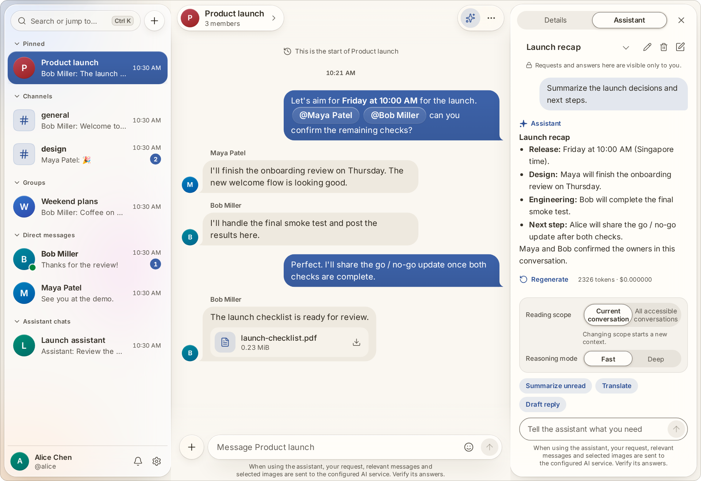
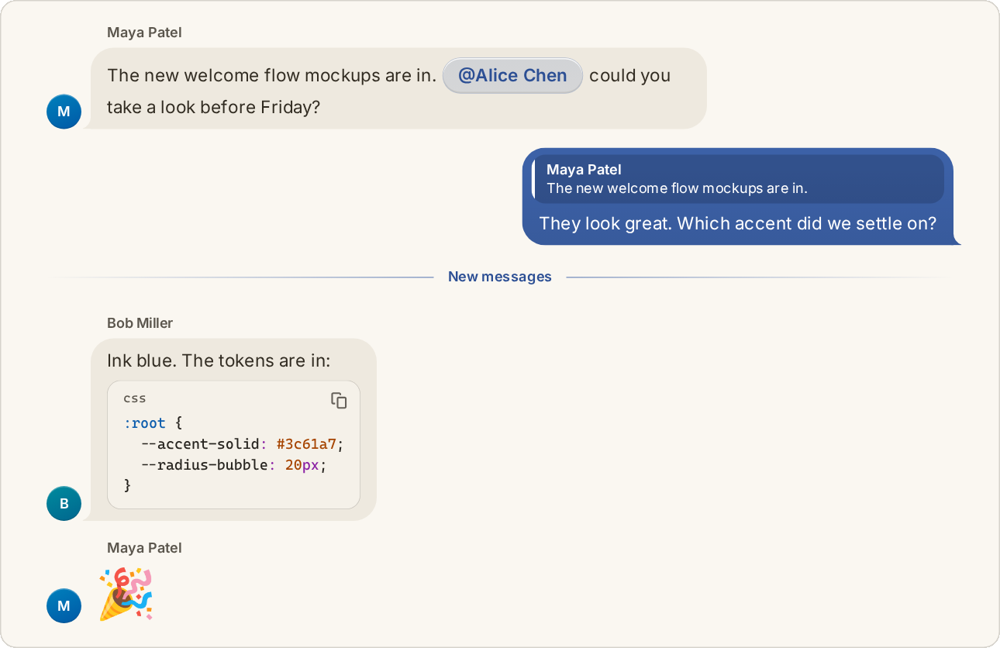
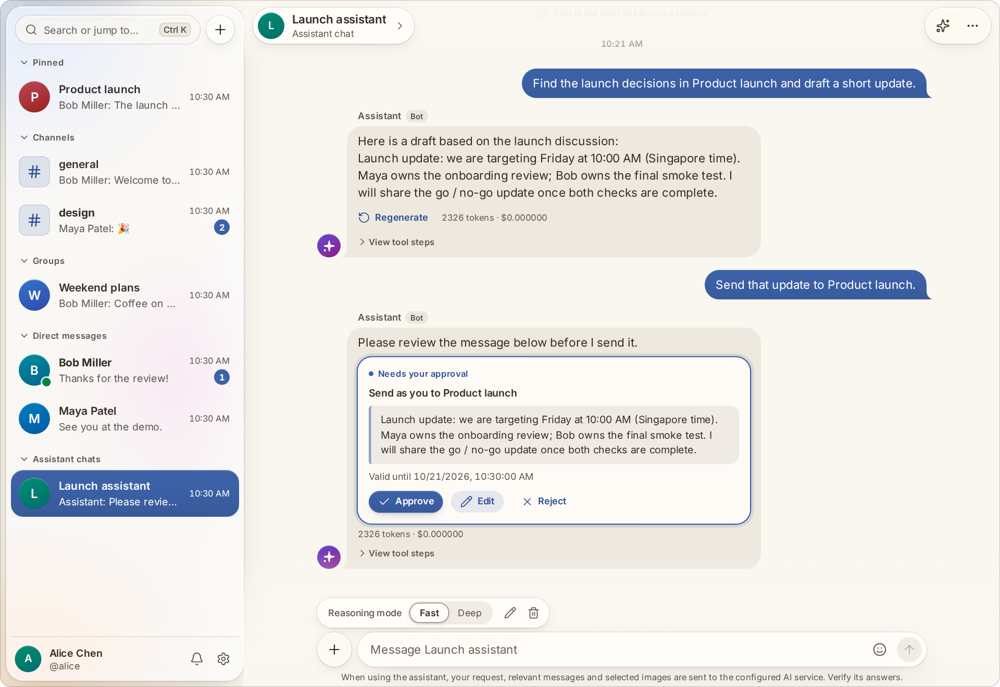
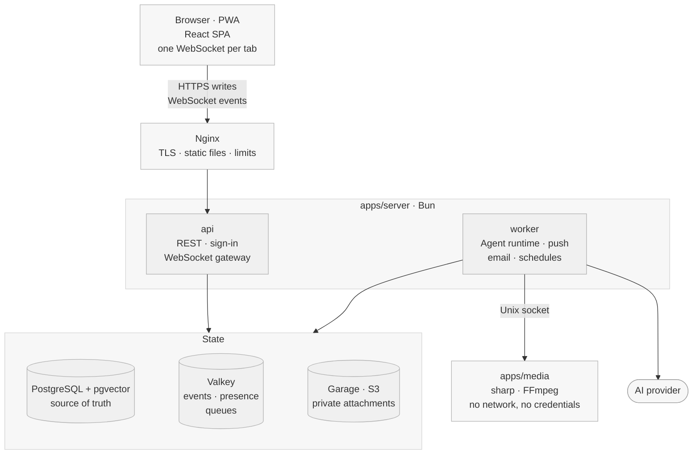

<p align="center">
  <strong>English</strong> &nbsp;·&nbsp; <a href="README.zh-CN.md">简体中文</a>
</p>

<p align="center">
  
</p>

<h1 align="center">ChatApp</h1>

<p align="center">
  Invite-only chat for a community, with a built-in Agent that works from<br>
  the conversations you can read and asks before it acts.
</p>

<p align="center">
  <a href="https://chatapp.software"><strong>Open ChatApp ↗</strong></a> &nbsp;·&nbsp;
  <a href="docs/demo.md">Product tour</a> &nbsp;·&nbsp;
  <a href="#how-it-is-built">How it is built</a> &nbsp;·&nbsp;
  <a href="#run-it-locally">Run it locally</a> &nbsp;·&nbsp;
  <a href="docs/00-overview.md">Docs</a>
</p>

<p align="center">
  <picture>
    <source media="(prefers-color-scheme: dark)" srcset="docs/assets/demo/03-agent-panel-dark.webp">
    
  </picture>
</p>

<p align="center">
  <sub>Real client, fictional people, scripted responses: no AI service is called and nothing is sent. The pictures follow your GitHub theme.</sub>
</p>

ChatApp is a real-time chat application built for communities of up to about a thousand members: channels, groups and direct messages, with files and media, in the browser or installed as a desktop app. An Agent is built in. It catches you up, searches, translates and drafts from what you are allowed to read, and once you approve the exact action it can send or schedule a message, create a group or invite people.

It runs at [chatapp.software](https://chatapp.software), where signing up needs an invitation code. The code is MIT licensed, and this repository holds the source, the infrastructure definitions and the operations tooling for running an instance of your own.

## Conversations

<p align="center">
  <picture>
    <source media="(prefers-color-scheme: dark)" srcset="docs/assets/demo/02-messages-dark.webp">
    
  </picture>
</p>

- **Channels, groups and direct messages.** Channels can be discovered and joined; groups are private and can hand out invitation links. Owners and admins rename, remove, ban, silence and archive. Every member pins, mutes and chooses a notification level for themselves.
- **Messages worth reading.** Markdown with highlighted code, quoted replies, @mentions and an emoji picker. By default a message can be edited for 24 hours and recalled for 2 minutes.
- **Files and media.** Drop a file anywhere in a conversation or paste an image. Pictures open in a gallery, video and audio play in place, and each conversation keeps a browser of what was shared in it.
- **In step everywhere.** Presence, typing, read positions and unread counts follow you across tabs and devices. After a dropped connection the client catches up from a sync log, and a message written offline is sent once the connection is back.
- **Search and notifications.** <kbd>Ctrl / ⌘</kbd> + <kbd>K</kbd> jumps to a conversation, runs a command or searches messages by keyword, with no AI involved. A notification center and optional browser push cover direct messages, mentions, replies and Agent approvals.
- **History starts when you join.** A new member sees a conversation from the moment they joined. Quotes, previews, search, attachments and the Agent all follow that same rule.

## An Agent that asks first

<p align="center">
  <picture>
    <source media="(prefers-color-scheme: dark)" srcset="docs/assets/demo/04-agent-approval-dark.webp">
    
  </picture>
</p>

- **Where you already are.** A private panel beside the conversation (<kbd>Ctrl / ⌘</kbd> + <kbd>J</kbd>), dedicated assistant chats, `@Agent` in a group or channel for an answer everyone sees, and `/summary`, `/translate` and `/draft` in the composer.
- **Reads, then helps.** It summarizes what you have not read, finds a discussion by keyword or by meaning, translates, drafts a reply and answers questions about an image. A draft lands in your composer, for you to send or discard.
- **Approval for anything that reaches others.** Sending or scheduling a message, creating a group and inviting members stop at a card that shows the destination and the exact content. You approve, edit or reject. Reminders and memories you ask for are created directly, shown, and can be undone.
- **Narrow by default.** The panel reads the current conversation unless you choose all of yours. A shared `@Agent` reply draws only on history that every current member can see and never on your memories, so text planted in a group cannot pull your private conversations into it.
- **Your key or the site's.** Use the site's allowance or your own DeepSeek API key. Administrators can audit runs made on the site's key for 30 days; for runs on your own key they see metadata only.
- **In the open.** Fast and Deep modes, streamed replies you can stop or regenerate, tool steps you can inspect, and usage counted against daily and monthly budgets.

Semantic search and image understanding depend on how an instance is configured. The full behavior is in the [Agent design](docs/06-agent.md) and the [security rules](docs/07-security.md).

## An interface that stays out of the way

<p align="center">
  
  
</p>

The client was rebuilt in November 2026 around one idea: the conversation fills the window, and navigation floats over it as glass.

- **Glass to navigate, a solid page to read.** The sidebar, the toolbar capsules, the composer and the inspector are glass. The message list never is, so text does not sit on a wallpaper.
- **Calm color.** A warm off-white light theme and a deep dark one; nine accents generated by one OKLCH rule, so they differ in hue and not in loudness; four levels of transparency and five text sizes.
- **Contrast is measured.** Every run of the checks verifies about 2,900 text, control and focus-ring pairs across all accents, both themes and each level of transparency.
- **Motion with a reason.** A new message rises from the composer, a menu grows from the control that opened it, and a theme change spreads from where you clicked. With “Reduce motion”, all of it becomes fades of at most 150 ms.
- **Keyboard and screen readers.** Everything is reachable from the command palette, and shortcuts cover the assistant, moving between conversations and Markdown formatting. Accessibility scans run in the browser tests, and the timeline has a paged mode for screen readers.
- **English and Chinese, installable.** Both languages ship in the same app, which installs as a desktop PWA with an unread badge.

The [product tour](docs/demo.md) walks through the rest: conversation details, assistant settings, the command palette, appearance and the narrow layout. The reasoning is in the [design system](docs/02-design-system.md).

## Community and privacy

- **By invitation.** Members invite members, five invitations each by default, and a new account verifies its email before it can sign in. Passkeys are supported, and everyone can review and sign out their own devices.
- **Moderation.** Any member can report a message. Site administrators manage members, invitations, channels and groups, reports, AI budgets and an audit log.
- **Privacy, stated plainly.** Administrators cannot read conversations they are not in, with two exceptions that are both audited: a reported message with five messages on either side of it, and Agent runs made on the site's key. There is no end-to-end encryption, so whoever operates a server can technically read its data. The privacy page inside the app says the same.

## How it is built



- **Writes go over HTTP, events over WebSocket.** Every change of state is an HTTP request with an idempotency key. The socket carries hints and passing signals such as typing and presence, never message bodies.
- **One place for the rules.** Routes, the WebSocket gateway, Agent tools and jobs are thin. Business logic, authorization and visibility live in `apps/server/src/domain/`, and a private resource you may not see answers 404, exactly like one that does not exist.
- **PostgreSQL is the source of truth.** A change, its sync-log entry and the work it triggers commit in one transaction. Queues and the event bus can be rebuilt from it, and clients reconcile against the log.
- **One rule for visibility.** A current member reads what came after they joined. Messages, quotes, previews, search, attachments and every read the Agent makes go through the same check, and streamed Agent output is authorized again batch by batch.
- **Untrusted media stays in a box.** Decoding runs in a separate container with no network and no credentials. The worker hands it bytes over a Unix socket and nothing else.
- **Deletion survives a restore.** In production a deletion is written to an offsite journal before it is confirmed, and a restore replays that journal first, so a backup cannot bring deleted content back.
- **Honest about what it cannot guarantee.** Model calls, email and push are not exactly-once. An unknown outcome is recorded and charged to the budget, not retried blindly.

| Layer | Built with |
| --- | --- |
| Client | React 19 with the React Compiler · Vite 8 · TanStack Router and Query · Tailwind CSS 4 · Base UI · Motion · Streamdown and Shiki · Paraglide · Workbox |
| Server | Bun 1.4 · Hono · Zod 4 · Drizzle ORM · Better Auth with passkeys · BullMQ · AI SDK 7 |
| Data | PostgreSQL 18 with pgvector · Valkey 9 · Garage (S3-compatible) |
| Media | sharp and FFmpeg in a container without a network |
| Quality | TypeScript 7 in strict mode · Biome · Bun test and Vitest · Playwright with axe · Storybook 10 · k6 |
| Operations | Docker Compose · Nginx · systemd timers · restic backups |

Exact versions are pinned in the workspace manifests, `bun.lock` and the files under `infra/`. The [architecture](docs/03-architecture.md), [data model](docs/04-data-model.md) and [API and realtime protocol](docs/05-api-and-realtime.md) go deeper.

## Run it locally

You need Bun 1.4.2, Node.js 24 or newer, and Docker with Compose. On Windows, work inside WSL with the repository on the Linux filesystem.

```bash
git clone https://github.com/liaboveall/ChatApp.git
cd ChatApp
bun install --frozen-lockfile
bun run setup            # writes .env.local with generated secrets
bun run infra:up         # PostgreSQL, Valkey, Garage and Mailpit
bun run infra:bootstrap  # prepares object storage
bun run db:migrate
bun run db:seed          # three demo members and a few conversations
bun run admin:create --email you@example.com --username you --name "Your Name"
bun run dev
```

`admin:create` asks for the administrator's password in the terminal. Open the address printed after `[dev] Open`, normally `http://localhost:5173`. Mail sent in development arrives in Mailpit at `http://localhost:8025`. The demo members are `alice`, `bob` and `carol` at `example.test`, and their password is `SEED_DEMO_PASSWORD` in `.env.local`.

Chat works without any AI configuration. For the Agent, put a key for the selected provider in `.env.local` and run `bun run doctor --ai`; the default provider is the NUS SoCLaaS gateway, and `AI_PROVIDER=deepseek` selects DeepSeek. `bun run doctor` diagnoses the rest of the environment. More in [local development](docs/09-local-dev.md); production uses its own configuration and release packages, described in [deployment](docs/10-deployment.md).

## Checks and tests

| Command | What it covers |
| --- | --- |
| `bun run check` | Formatting and lint, types, architecture and secret boundaries, unit tests, contrast, messages in both languages |
| `bun run build` | The production client and its service worker |
| `bun run test:integration` | Integration, security, contract and realtime suites against real PostgreSQL, Valkey and Garage |
| `bun run test:e2e` | Browser scenarios against real local services in Chromium, WebKit and Firefox |
| `bun run test:review` | Component regressions in a browser, on synthetic HTTP data |
| `bun run test:visual` | Storybook screenshot baselines, inside the official Playwright container |
| `bun run storybook` | The component workshop |
| `bun run demo:capture` | The pictures on this page, in both themes; add `--locale=zh-CN` for the Chinese set |

The first two need no services. The rest need the development infrastructure, and suites that share the test database run one at a time. Seven GitHub Actions workflows run for every push and pull request on `main`: check, integration, e2e, media, embeddings, images and security. An evaluation against a real model is started by hand. The [testing guide](docs/08-testing.md) has the full list.

## Repository

```text
apps/web/            React client and PWA, Storybook, browser and visual tests
apps/server/         API, WebSocket gateway, worker, Agent runtime, admin CLI, evals
apps/media/          Media runtime that runs without a network
packages/contracts/  Zod schemas shared by client and server: DTOs, events, limits
packages/db/         Drizzle schema, migrations, bootstrap and development seed
infra/               Compose files, images, Nginx and systemd templates, load script
scripts/             Development, test, release, backup and diagnostic tools
docs/                Specifications, guides and the product tour
```

## Documentation

| Document | What is in it |
| --- | --- |
| [Product tour](docs/demo.md) | The application in ten pictures, and how to retake them |
| [Product specification](docs/01-product-spec.md) | Chat, Agent, administration, privacy and defaults |
| [Design system](docs/02-design-system.md) | Glass, tokens, layout, motion and components |
| [Architecture](docs/03-architecture.md) | Layers, data flow, realtime sync and background work |
| [Data model](docs/04-data-model.md) | Tables, invariants, migrations and retention |
| [API and realtime protocol](docs/05-api-and-realtime.md) | REST, DTOs, WebSocket and the sync contract |
| [Agent design](docs/06-agent.md) | Tools, scopes, approvals, context and evaluation |
| [Security rules](docs/07-security.md) | Threat model, requirements and regressions |
| [Local development](docs/09-local-dev.md) · [Testing](docs/08-testing.md) | Environment, services and every suite |
| [Deployment](docs/10-deployment.md) · [Operations](docs/operations.md) | Release packages, updates, backup and recovery |
| [Maintenance principles](docs/12-decisions.md) · [Maintenance log](docs/maintenance.md) | Standing constraints and what changed when |

The READMEs and the product tour exist in English and Chinese. The engineering documentation is written in Chinese.

## Not here yet

The desktop comes first: narrow windows reflow into a single column, and phone gestures are not done. Reactions, pinned messages, threads, forwarding, link previews, voice messages, web search for the Agent and MCP tools are planned for later. Calls, end-to-end encryption and disappearing messages are out of scope.

## History and license

`main` is the maintained line, formerly `v2`. The first version, a Django and Channels application adapted from [rustyxlol/Django-ChatApp](https://github.com/rustyxlol/Django-ChatApp), is kept in [`archive/v1`](https://github.com/liaboveall/ChatApp/tree/archive/v1) and [`v1-legacy`](https://github.com/liaboveall/ChatApp/tree/v1-legacy). The plans, reviews and prototypes of the rewrite are kept in [`v2-pre-cleanup-2026-10-20`](https://github.com/liaboveall/ChatApp/tree/v2-pre-cleanup-2026-10-20).

Released under the [MIT License](LICENSE), which retains the original author's notice.
