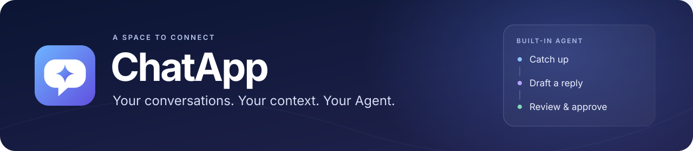
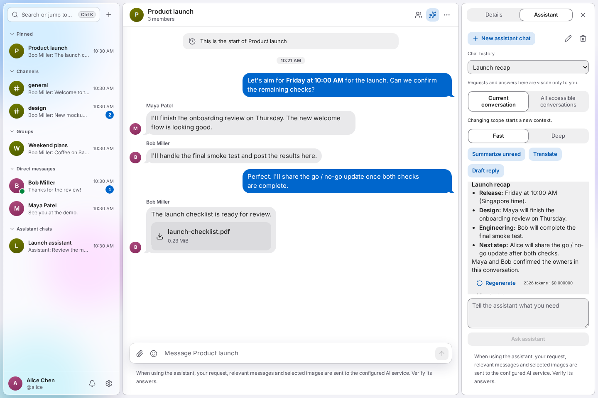
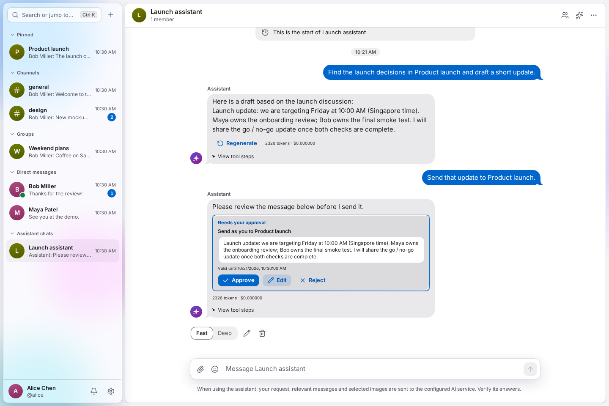
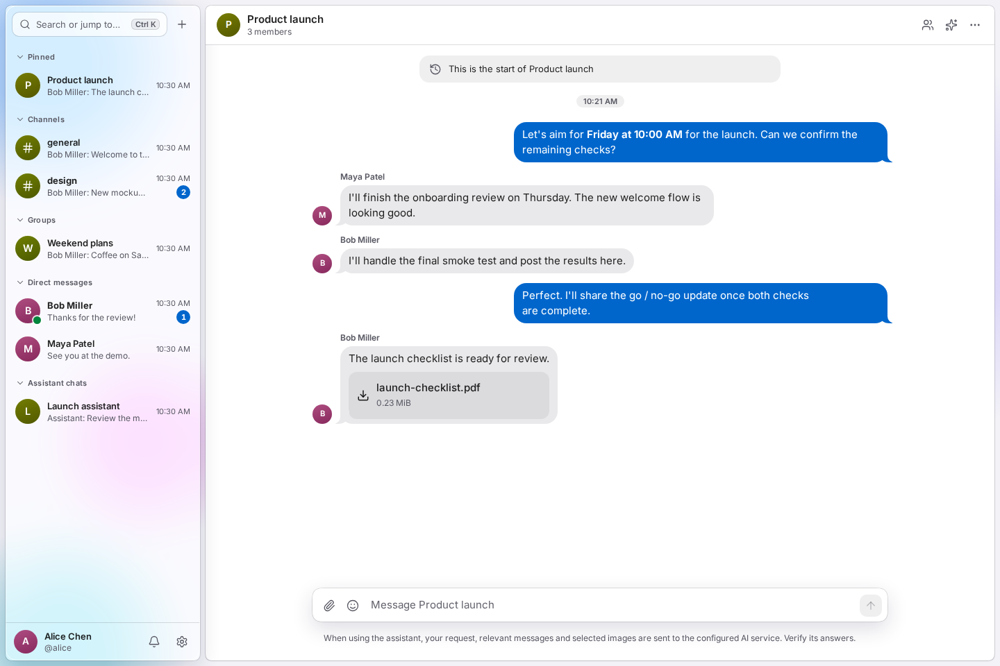
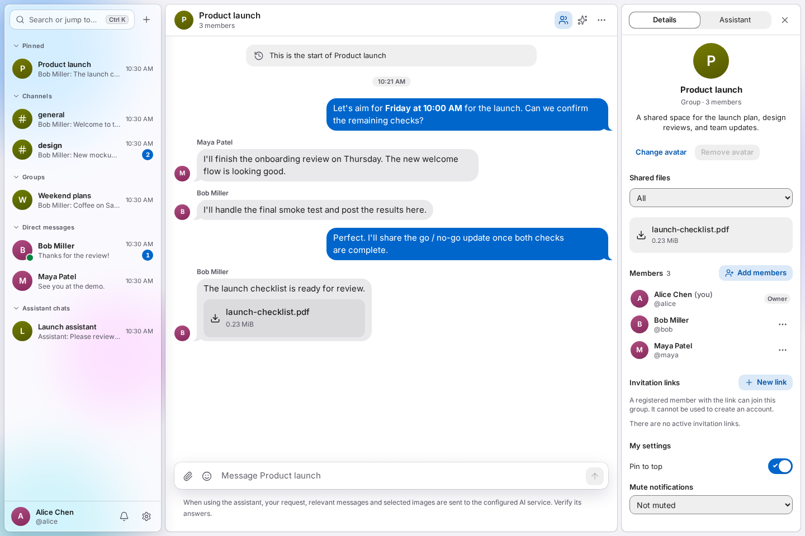
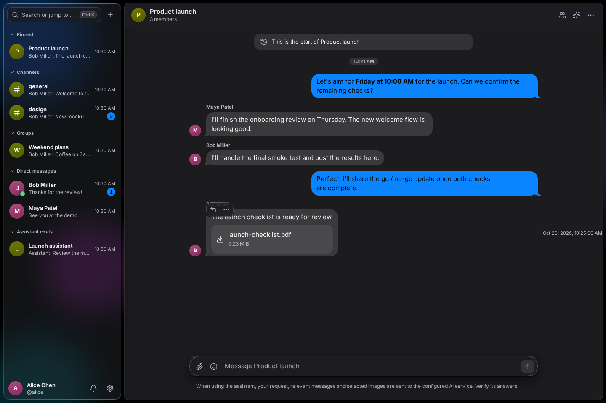
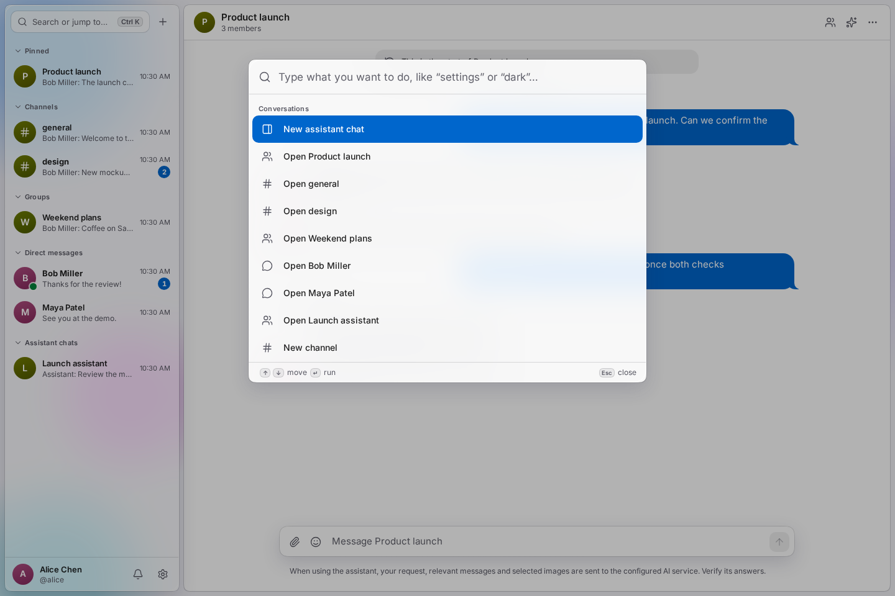

<p align="center">
  <strong>English</strong> &nbsp;·&nbsp; <a href="README.zh-CN.md">简体中文</a>
</p>

<p align="center">
  <picture>
    <source media="(max-width: 600px)" srcset="docs/assets/readme/hero-en-compact.svg">
    
  </picture>
</p>

<p align="center">
  A private community for conversations, shared files, and an Agent that helps you take the next step.
</p>

<p align="center">
  <a href="https://chatapp.software"><strong>Open ChatApp ↗</strong></a> &nbsp;·&nbsp;
  <a href="#see-it-in-action">Watch the demo</a> &nbsp;·&nbsp;
  <a href="#an-agent-in-the-conversation">Explore the Agent</a> &nbsp;·&nbsp;
  <a href="#quick-start">Quick start</a> &nbsp;·&nbsp;
  <a href="docs/00-overview.md">Docs</a>
</p>

<p align="center">
  <kbd>Built-in Agent</kbd> &nbsp; <kbd>Real-time chat</kbd> &nbsp; <kbd>Installable PWA</kbd> &nbsp; <kbd>MIT licensed</kbd>
</p>

---

<p align="center">
  
  <br>
  <sub>The discussion on the left. Your private assistant on the right. Everything in context.</sub>
</p>

<table>
  <tr>
    <td width="33%" valign="top"><strong>A place for your people</strong><br><br>Channels, groups, DMs, and files keep the conversation together.</td>
    <td width="33%" valign="top"><strong>Help that knows the context</strong><br><br>Catch up, find a decision, translate, or draft with the built-in Agent.</td>
    <td width="33%" valign="top"><strong>You make the call</strong><br><br>Review the destination and content before the Agent acts for you.</td>
  </tr>
</table>

## See it in action

A launch discussion becomes a recap, a draft, and a message ready for approval.


<p align="center">
  Discuss &nbsp;→&nbsp; Summarize &nbsp;→&nbsp; Draft &nbsp;→&nbsp; Review &amp; approve
  <br><br>
  <a href="docs/demo.md"><strong>Take the full screenshot tour →</strong></a>
</p>

<sub>Captured from the real English client with fictional people and scripted, browser-local responses. AI answers and approval outcomes are simulated; no live AI calls or messages are sent. The hosted app requires an invitation.</sub>

## An Agent in the conversation

Ask a question where you're already working. The Agent can retrieve relevant chat context, prepare an answer, and propose the next action.

| Catch up | Find and create | Follow through |
| --- | --- | --- |
| Summarize unread messages and decisions. Translate a message. Ask about an image. | Search your accessible conversations. Find related discussions with semantic retrieval. Draft a reply. | Send or schedule a message, create a group, or invite members **after your approval**. Create personal reminders and explicitly requested memories with visible results and undo controls. |

**One assistant, several ways in.** Open the private side panel, keep a dedicated assistant chat, mention `@Agent` in a group or channel, or use `/summary`, `/translate`, and `/draft`. Choose **Fast** or **Deep**, watch replies stream, stop a running response, or regenerate an eligible completed reply.

### A draft becomes an action—with your say

> **You:** “Find the launch discussion and draft a short update.”<br>
> **Agent:** Finds the context and prepares a draft.<br>
> **You:** “Send that update to Product launch.”<br>
> **Next:** Review the target and message. Approve, edit, or reject.



<p align="center"><sub>A proposed send stays in your hands until you approve it.</sub></p>

<details>
<summary><strong>Your context, preferences, and privacy</strong></summary>

- **Choose the scope.** The side panel starts with **Current conversation**. **All accessible conversations** is an explicit choice. Shared `@Agent` replies use only the current conversation's shared visible history and do not load personal memories.
- **Bring your own key.** Use the site's allowance or your own **DeepSeek API key**. Check usage and manage memories, reminders, and scheduled messages in **Settings → Assistant**.
- **Inspect the work.** Open **View tool steps** to see the tools used for a reply. Drafts can be inserted into the composer for review before you share them.
- **Know the boundaries.** The Agent follows your access permissions, including the limit on pre-join history. Site-key run content can be audited by administrators during retention; personal-key run content is restricted to its owner. Relevant content is sent to the configured AI provider.

AI, image understanding, and semantic retrieval depend on instance configuration. Review AI answers before relying on them. Read the [Agent design](docs/06-agent.md) and [security rules](docs/07-security.md) for the full behavior.

</details>

## Built for everyday conversation

<table>
  <tr>
    <td width="50%" valign="top"><br><br><strong>Talk, share, stay in sync</strong><br>Markdown, replies, mentions, file sharing, presence, typing indicators, unread counts, and reconnect catch-up.</td>
    <td width="50%" valign="top"><br><br><strong>Keep the details close</strong><br>Browse shared files, see members, manage invitation links, and choose your conversation notifications.</td>
  </tr>
  <tr>
    <td valign="top"><br><br><strong>Make it feel like yours</strong><br>Light and dark, accent colors, glass effects, text size, reduced motion, English and Chinese, and a desktop PWA.</td>
    <td valign="top"><br><br><strong>Keep your hands on the keyboard</strong><br>Jump, search, and run commands with <kbd>Ctrl / ⌘</kbd> + <kbd>K</kbd>. Keyword search uses no AI allowance.</td>
  </tr>
</table>

Invite-only registration, passkeys, device management, reports, moderation, and audit controls support the community. The notification center and optional browser push help you keep up with mentions, replies, DMs, and Agent approvals.

## Quick start

**Prerequisites:** Bun **1.4.2**, Node.js **24+** (CI uses 26), and Docker Compose. On Windows, use WSL with the repository in the Linux filesystem and Docker Desktop's WSL integration enabled.

```bash
git clone https://github.com/liaboveall/ChatApp.git
cd ChatApp
bun install --frozen-lockfile
bun run setup
bun run infra:up
bun run infra:bootstrap
bun run db:migrate
bun run db:seed
bun run admin:create
bun run dev
```

Open the address printed after `[dev] Open`—normally `http://localhost:5173`. Development email is available at `http://localhost:8025`.

<details>
<summary><strong>Configuration and production setup</strong></summary>

`setup` creates ignored local configuration and secrets. `db:seed` is for development data. Configure AI credentials locally and check the connection with `bun run doctor --ai`. Production uses separate configuration and `db:bootstrap`; follow the [deployment guide](docs/10-deployment.md).

</details>

## Under the hood

| Web / PWA | API / Agent | Data / jobs | Media / deployment |
| --- | --- | --- | --- |
| React · Vite · TanStack Router / Query · Tailwind CSS · Base UI | TypeScript · Bun · Hono · Zod · Better Auth · AI SDK | PostgreSQL / pgvector · Drizzle · Valkey · BullMQ | Garage / S3 · Isolated media processing · Docker Compose · Nginx · systemd |

<details>
<summary><strong>Development commands and repository layout</strong></summary>

| Command | Purpose |
| --- | --- |
| `bun run check` | Formatting, types, architecture boundaries, unit tests, contrast, and translations |
| `bun run build` | Build the production client |
| `bun run test:integration` | Tests with real database, cache, and object storage |
| `bun run test:e2e` | Browser tests against real local services |
| `bun run test:review` | Component browser regressions |
| `bun run test:visual` | Storybook visual regressions |
| `bun run storybook` | Component development and previews |
| `bun run demo:capture` | Refresh English demo screenshots; add `--locale=zh-CN` for Chinese |
| `bun run doctor` | Diagnose the local environment and services |

Integration and browser tests need a prepared environment. Suites sharing a test database must run serially. See the [testing guide](docs/08-testing.md).

```text
apps/web/           Web / PWA client, components, and browser tests
apps/server/        API, WebSocket, jobs, Agent, admin CLI, and evals
apps/media/         Isolated media processing
packages/contracts/ Shared validation and protocols
packages/db/        Models, migrations, bootstrap, and development seeds
infra/              Compose, images, Nginx, and systemd
scripts/            Development, testing, release, backup, and diagnostics
docs/               Product tours, engineering, and operations
```

Versions are pinned in workspace manifests, `bun.lock`, and infrastructure definitions.

</details>

<p align="center">
  <a href="docs/demo.md">Product tour</a> &nbsp;·&nbsp;
  <a href="docs/09-local-dev.md">Local development</a> &nbsp;·&nbsp;
  <a href="docs/03-architecture.md">Architecture</a> &nbsp;·&nbsp;
  <a href="docs/06-agent.md">Agent</a> &nbsp;·&nbsp;
  <a href="docs/07-security.md">Security</a> &nbsp;·&nbsp;
  <a href="docs/10-deployment.md">Deployment</a> &nbsp;·&nbsp;
  <a href="docs/operations.md">Operations</a>
</p>

<sub>READMEs and product tours are available in English and Chinese. Detailed engineering documentation is primarily in Chinese.</sub>

<details>
<summary><strong>Project history and attribution</strong></summary>

`main` is the maintenance branch (previously `v2`). The original Django + Channels application is preserved in [`archive/v1`](https://github.com/liaboveall/ChatApp/tree/archive/v1) and [`v1-legacy`](https://github.com/liaboveall/ChatApp/tree/v1-legacy). Earlier plans, reviews, milestone reports, and prototypes are preserved in [`v2-pre-cleanup-2026-10-20`](https://github.com/liaboveall/ChatApp/tree/v2-pre-cleanup-2026-10-20). See the [maintenance notes](docs/maintenance.md).

The original version was adapted from [rustyxlol/Django-ChatApp](https://github.com/rustyxlol/Django-ChatApp); its attribution is retained in the license.

</details>

---

<p align="center">
  <strong>ChatApp</strong> &nbsp;·&nbsp; <a href="LICENSE">MIT License</a> &nbsp;·&nbsp; <a href="README.zh-CN.md">阅读中文版 →</a>
</p>
