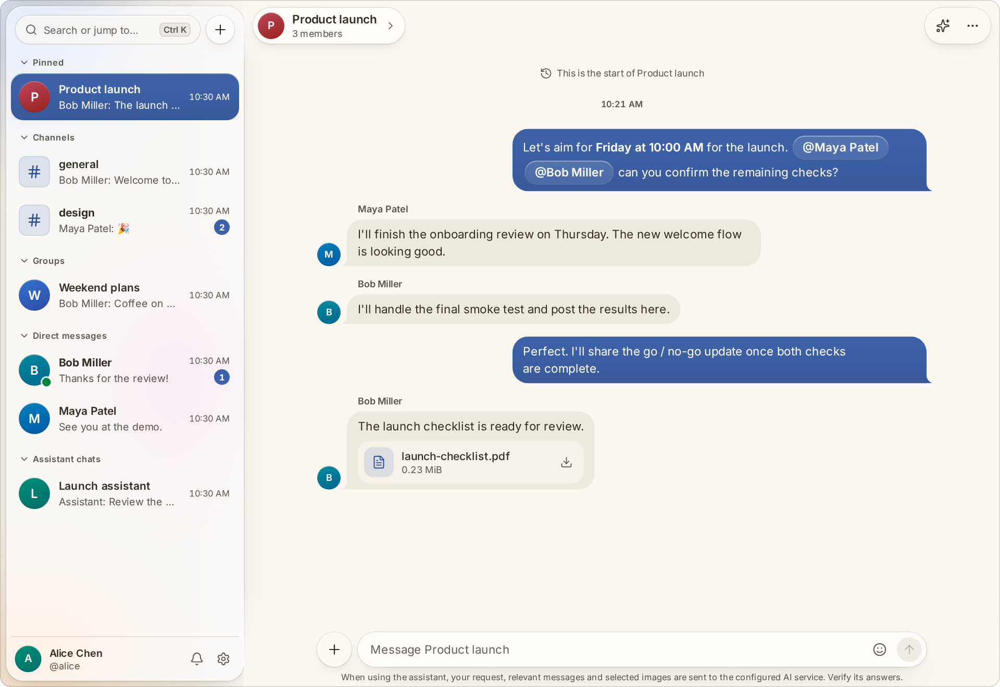
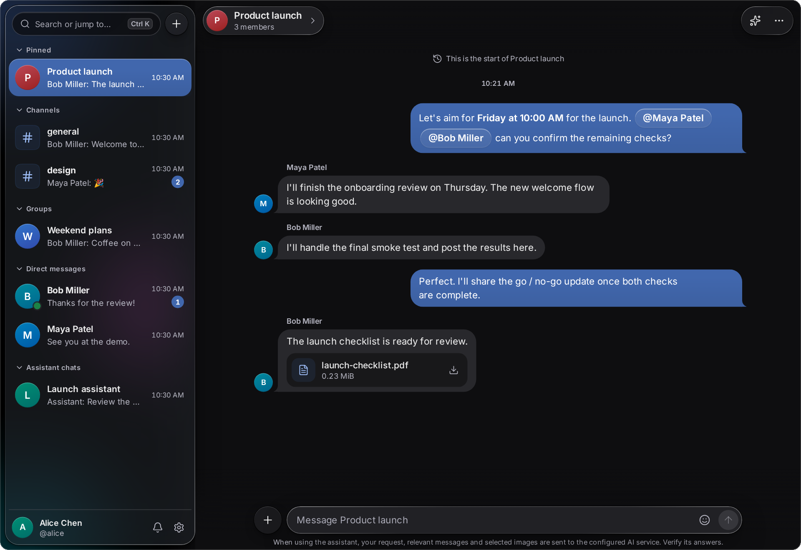
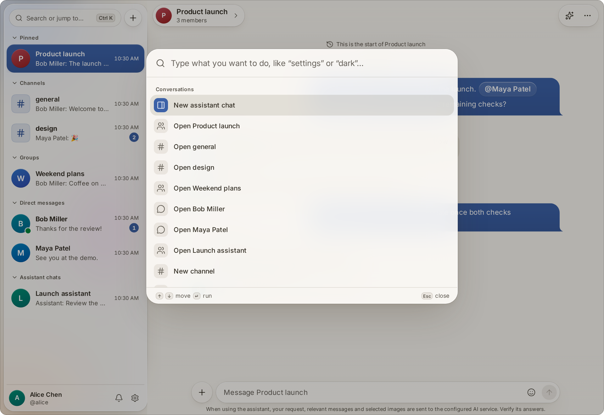
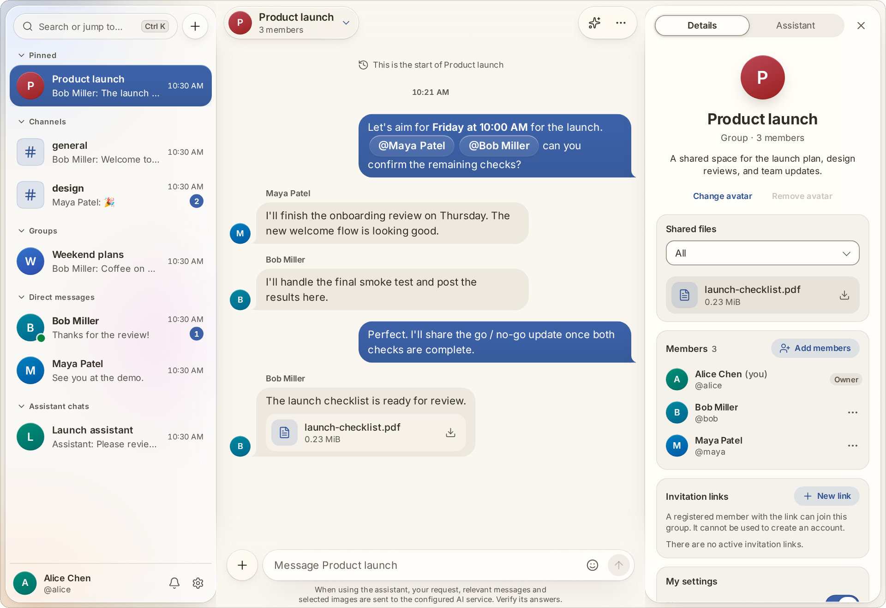
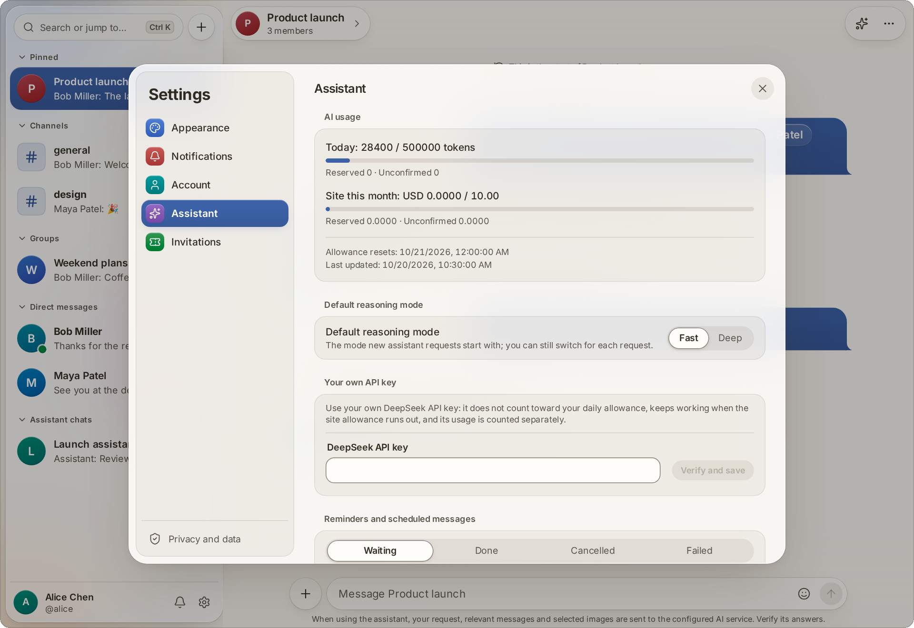
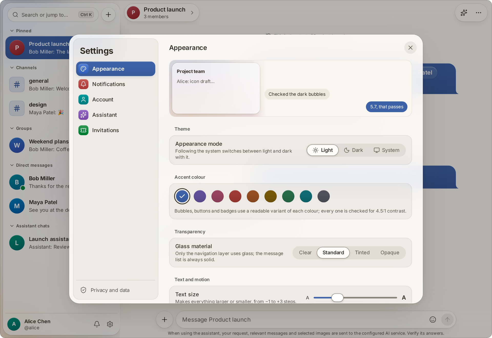

<p align="center">
  <strong>English</strong> &nbsp;·&nbsp; <a href="README.zh-CN.md">简体中文</a>
</p>

<p align="center">
  
</p>

<h1 align="center">ChatApp</h1>

<p align="center">
  Invite-only chat for a community, with a built-in Agent that works from<br>
  the conversations you can read and asks before it acts.
</p>

<p align="center">
  <a href="https://chatapp.software"><strong>Open ChatApp ↗</strong></a> &nbsp;·&nbsp;
  <a href="docs/demo.md">Product tour</a> &nbsp;·&nbsp;
  <a href="#run-it-locally">Run it locally</a> &nbsp;·&nbsp;
  <a href="docs/00-overview.md">Docs</a>
</p>

<p align="center">
  <picture>
    <source media="(prefers-color-scheme: dark)" srcset="docs/assets/demo/03-agent-panel-dark.webp">
    
  </picture>
</p>

<p align="center">
  <sub>Captured from the real client, with fictional people and conversations. The pictures follow your GitHub theme.</sub>
</p>

<h2 align="center">Everything a conversation needs</h2>

<p align="center">
  Channels, groups and direct messages; replies, mentions, Markdown and highlighted code.<br>
  Pictures, video, audio and files open in place, and every device stays in sync.
</p>

<p align="center">
  <picture>
    <source media="(prefers-color-scheme: dark)" srcset="docs/assets/demo/02-messages-dark.webp">
    
  </picture>
</p>

<h2 align="center">An Agent that asks before it acts</h2>

<p align="center">
  It reads only the conversations you can read, and catches you up, searches, translates and drafts.<br>
  Before it sends a message, creates a group or invites someone, it shows you the action and waits.
</p>

<p align="center">
  <picture>
    <source media="(prefers-color-scheme: dark)" srcset="docs/assets/demo/04-agent-approval-dark.webp">
    
  </picture>
</p>

<h2 align="center">An interface that stays out of the way</h2>

<p align="center">
  The conversation fills the window, and navigation floats above it as glass.<br>
  Light and dark, nine accents, four levels of transparency, every combination checked for contrast.
</p>

<p align="center">
  
  
</p>

<h2 align="center">And the rest</h2>

<p align="center">
  A command palette, members and files, and an assistant and an appearance of your own.
</p>

<p align="center">
  <picture>
    <source media="(prefers-color-scheme: dark)" srcset="docs/assets/demo/08-command-palette-dark.webp">
    
  </picture>
  <picture>
    <source media="(prefers-color-scheme: dark)" srcset="docs/assets/demo/06-details-dark.webp">
    
  </picture>
</p>

<p align="center">
  <picture>
    <source media="(prefers-color-scheme: dark)" srcset="docs/assets/demo/07-assistant-settings-dark.webp">
    
  </picture>
  <picture>
    <source media="(prefers-color-scheme: dark)" srcset="docs/assets/demo/09-appearance-dark.webp">
    
  </picture>
</p>

<p align="center">
  <strong>Invite-only</strong> &nbsp;·&nbsp;
  <strong>Passkey sign-in</strong> &nbsp;·&nbsp;
  <strong>English and Chinese</strong> &nbsp;·&nbsp;
  <strong>Installs as a desktop app</strong> &nbsp;·&nbsp;
  <a href="docs/01-product-spec.md#411-隐私与数据说明">Privacy, stated plainly</a>
</p>

<p align="center">
  <a href="docs/demo.md"><strong>The whole app in ten pictures →</strong></a>
</p>

<p align="center">
  <sub>ChatApp runs at <a href="https://chatapp.software">chatapp.software</a>, where signing up needs an invitation code. This repository can also run an instance of your own.</sub>
</p>

## Run it locally

You need Bun 1.4.2, Node.js 24 or newer, and Docker with Compose. On Windows, work inside WSL.

```bash
git clone https://github.com/liaboveall/ChatApp.git
cd ChatApp
bun install --frozen-lockfile
bun run setup            # writes .env.local and random secrets
bun run infra:up         # PostgreSQL, Valkey, Garage and Mailpit
bun run infra:bootstrap  # prepares object storage
bun run db:migrate
bun run db:seed          # three demo members and a few conversations
bun run admin:create --email you@example.com --username you --name "Your Name"
bun run dev              # open the address printed after [dev] Open
```

Chat works without an AI key. For the Agent's configuration, the tests and deployment, see [local development](docs/09-local-dev.md), the [testing guide](docs/08-testing.md) and the [deployment guide](docs/10-deployment.md).

## Stack and documents

React 19 · Vite · Tailwind CSS 4 · Bun · Hono · PostgreSQL with pgvector · Valkey · Garage · Docker Compose

[Architecture](docs/03-architecture.md) · [Agent design](docs/06-agent.md) · [Design system](docs/02-design-system.md) · [Security](docs/07-security.md) · [Product specification](docs/01-product-spec.md) · [All documents](docs/00-overview.md) (in Chinese)

Released under the [MIT License](LICENSE). The first version, a Django app adapted from [rustyxlol/Django-ChatApp](https://github.com/rustyxlol/Django-ChatApp), is kept in [`archive/v1`](https://github.com/liaboveall/ChatApp/tree/archive/v1).
