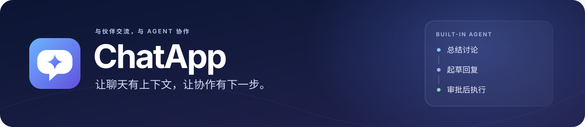
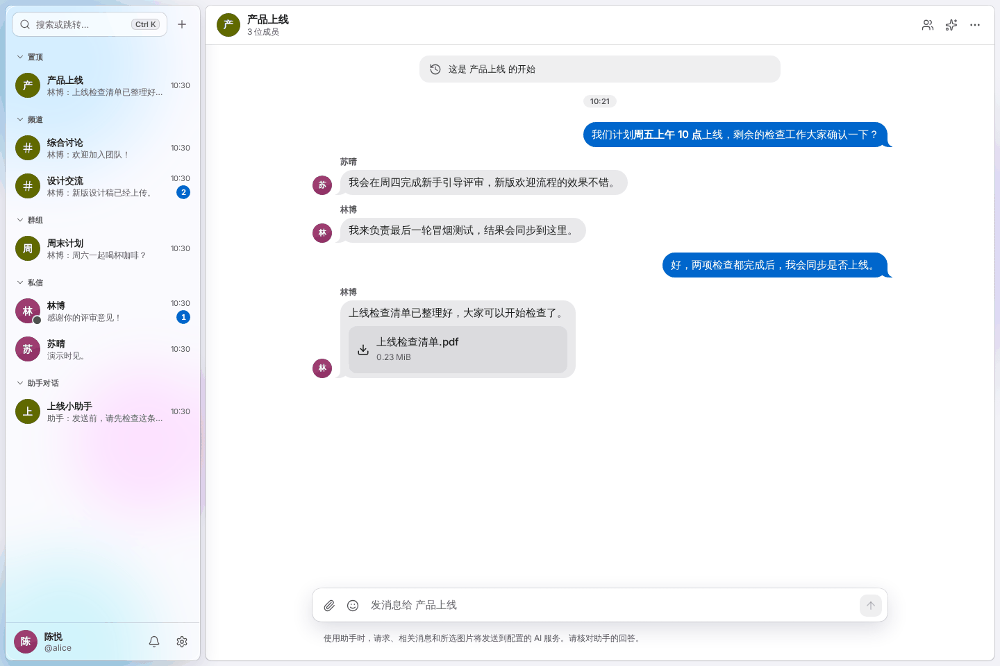

<p align="center">
  <a href="README.md">English</a> &nbsp;·&nbsp; <strong>简体中文</strong>
</p>

<p align="center">
  <picture>
    <source media="(max-width: 600px)" srcset="docs/assets/readme/hero-zh-CN-compact.svg">
    
  </picture>
</p>

<p align="center">
  与伙伴聊天、分享文件，让内置 Agent 帮你整理讨论、起草回复、推进下一步。
</p>

<p align="center">
  <a href="https://chatapp.software"><strong>打开 ChatApp ↗</strong></a> &nbsp;·&nbsp;
  <a href="#看看实际体验">产品演示</a> &nbsp;·&nbsp;
  <a href="#对话里的-agent">认识 Agent</a> &nbsp;·&nbsp;
  <a href="#快速开始">快速开始</a> &nbsp;·&nbsp;
  <a href="docs/00-overview.md">项目文档</a>
</p>

<p align="center">
  <kbd>内置 Agent</kbd> &nbsp; <kbd>实时聊天</kbd> &nbsp; <kbd>可安装 PWA</kbd> &nbsp; <kbd>MIT 开源</kbd>
</p>

---

<p align="center">
  
  <br>
  <sub>左边是团队讨论，右边是只对你可见的助手。上下文就在眼前。</sub>
</p>

<table>
  <tr>
    <td width="33%" valign="top"><strong>伙伴们的交流空间</strong><br><br>频道、群组、私信和文件，让讨论与资料留在一起。</td>
    <td width="33%" valign="top"><strong>理解上下文的帮助</strong><br><br>让 Agent 帮你补齐进展、查找决定、翻译消息、起草回复。</td>
    <td width="33%" valign="top"><strong>行动由你决定</strong><br><br>助手代你执行操作前，先检查目标和内容，再批准、修改或拒绝。</td>
  </tr>
</table>

## 看看实际体验

从一次产品上线讨论，到安排总结、更新草稿，再到发送前的审批。



<p align="center">
  一起讨论 &nbsp;→&nbsp; 整理进展 &nbsp;→&nbsp; 起草更新 &nbsp;→&nbsp; 审批执行
  <br><br>
  <a href="docs/demo.zh-CN.md"><strong>查看完整截图导览 →</strong></a>
</p>

<sub>截图来自真实中文客户端，人物与消息为虚构数据，AI 回答和审批结果由浏览器内的演示响应提供。演示不调用真实 AI，也不发送真实消息。在线应用需要邀请才能注册。</sub>

## 对话里的 Agent

在你正在讨论的地方直接提问。Agent 可以检索相关聊天记录、整理答案，并提出下一步操作。

| 补齐进展 | 查找与创作 | 推进下一步 |
| --- | --- | --- |
| 总结未读消息和讨论决定，翻译消息，理解所选图片。 | 搜索你有权访问的会话，用语义检索找到相关讨论，起草回复。 | **经你批准后**发送或定时发送消息、建群、邀请成员。个人提醒和明确要求保存的记忆会显示结果，并提供撤销入口。 |

**同一个助手，多种使用方式。** 打开私有侧边面板，创建专属助手对话，在群组或频道里 `@Agent`，或者使用 `/summary`、`/translate`、`/draft`。支持选择**快速**或**深入**模式、流式输出、停止生成，以及对符合条件的已完成回复重新生成。

### 从草稿到行动，先由你确认

> **你：**“找到上线讨论，帮我起草一条简短的进展更新。”<br>
> **Agent：**检索相关上下文，整理出更新草稿。<br>
> **你：**“把这条更新发到「产品上线」。”<br>
> **接下来：**检查目标与正文，选择批准、修改或拒绝。


<p align="center"><sub>发送前，先看清要发什么、发到哪里。</sub></p>

<details>
<summary><strong>上下文、个人偏好与隐私</strong></summary>

- **读取范围由你选。** 侧边助手默认只读**当前会话**，扩大到**所有可访问会话**需要明确选择。群内 `@Agent` 只使用当前会话成员共同可见的历史，不加载个人记忆。
- **可以自带密钥。** 使用站点提供的额度，或填写自己的 **DeepSeek API key**。在**设置 → 助手**查看用量、管理记忆、提醒与定时消息。
- **过程可以查看。** 展开**查看工具步骤**，了解回答使用的工具。草稿可以插入聊天输入框，检查后再分享。
- **权限边界保持一致。** 助手遵守你的访问权限，不能读取加入前的历史。站点密钥运行内容可在保留期内由管理员审计；个人密钥运行内容仅本人可见。相关内容会发送到配置的 AI 服务。

AI、图片理解和语义检索取决于实例配置。使用前请核对助手的回答。完整行为见 [Agent 设计](docs/06-agent.md)与[安全规范](docs/07-security.md)。

</details>

## 日常聊天，也认真做好

<table>
  <tr>
    <td width="50%" valign="top"><br><br><strong>交流、分享，保持同步</strong><br>Markdown、回复、提及、文件分享、在线状态、输入提示、未读数，以及断线后的消息补齐。</td>
    <td width="50%" valign="top"><br><br><strong>需要的信息，就在旁边</strong><br>浏览共享文件、查看成员、管理邀请链接，设置当前会话的通知偏好。</td>
  </tr>
  <tr>
    <td valign="top"><br><br><strong>调整成喜欢的样子</strong><br>深浅主题、强调色、玻璃效果、字号、减少动画、中英双语，以及可安装的桌面 PWA。</td>
    <td valign="top"><br><br><strong>用键盘也能轻快操作</strong><br><kbd>Ctrl / ⌘</kbd> + <kbd>K</kbd> 打开命令面板，搜索消息、跳转会话、执行操作。关键词搜索不消耗 AI 额度。</td>
  </tr>
</table>

邀请注册、Passkey、设备管理、消息举报、成员管理和审计工具，帮助维护社区。通知中心和可选的浏览器推送，让私信、提及、回复与 Agent 审批更容易被看到。

## 快速开始

**环境要求：** Bun **1.4.2**、Node.js **24+**（CI 使用 26）和 Docker Compose。Windows 推荐使用 WSL，将仓库放在 Linux 文件系统中，并启用 Docker Desktop 的 WSL 集成。

```bash
git clone https://github.com/liaboveall/ChatApp.git
cd ChatApp
bun install --frozen-lockfile
bun run setup
bun run infra:up
bun run infra:bootstrap
bun run db:migrate
bun run db:seed
bun run admin:create
bun run dev
```

打开终端 `[dev] Open` 显示的地址，通常是 `http://localhost:5173`。开发邮件可在 `http://localhost:8025` 查看。

<details>
<summary><strong>本地配置与生产环境</strong></summary>

`setup` 生成被 Git 忽略的本地配置和密钥，`db:seed` 仅用于开发数据。AI 凭据在本机配置，通过 `bun run doctor --ai` 检查连接。生产环境使用独立配置和 `db:bootstrap`，请按[部署指南](docs/10-deployment.md)操作。

</details>

## 技术实现

| Web / PWA | API / Agent | 数据与任务 | 媒体与部署 |
| --- | --- | --- | --- |
| React · Vite · TanStack Router / Query · Tailwind CSS · Base UI | TypeScript · Bun · Hono · Zod · Better Auth · AI SDK | PostgreSQL / pgvector · Drizzle · Valkey · BullMQ | Garage / S3 · 隔离媒体处理 · Docker Compose · Nginx · systemd |

<details>
<summary><strong>开发命令与仓库结构</strong></summary>

| 命令 | 用途 |
| --- | --- |
| `bun run check` | 格式、类型、架构边界、单元测试、对比度与双语文案 |
| `bun run build` | 构建生产客户端 |
| `bun run test:integration` | 使用真实数据库、缓存和对象存储的集成测试 |
| `bun run test:e2e` | 使用真实本地服务的浏览器测试 |
| `bun run test:review` | 组件浏览器回归 |
| `bun run test:visual` | Storybook 视觉回归 |
| `bun run storybook` | 组件开发与预览 |
| `bun run demo:capture` | 更新英文演示截图；添加 `--locale=zh-CN` 更新中文截图 |
| `bun run doctor` | 本地环境与服务诊断 |

集成和浏览器测试需要先准备测试环境，共享测试库的套件应串行运行。详见[测试指南](docs/08-testing.md)。

```text
apps/web/           Web / PWA 客户端、组件与浏览器测试
apps/server/        API、WebSocket、任务、Agent、管理 CLI 与评测
apps/media/         隔离媒体处理
packages/contracts/ 共享校验与协议
packages/db/        模型、迁移、初始化与开发种子
infra/              Compose、镜像、Nginx 与 systemd
scripts/            开发、测试、发布、备份及诊断
docs/               产品演示、工程与运维文档
```

具体版本以工作区配置、`bun.lock` 和基础设施定义为准。

</details>

<p align="center">
  <a href="docs/demo.zh-CN.md">产品导览</a> &nbsp;·&nbsp;
  <a href="docs/09-local-dev.md">本地开发</a> &nbsp;·&nbsp;
  <a href="docs/03-architecture.md">架构</a> &nbsp;·&nbsp;
  <a href="docs/06-agent.md">Agent</a> &nbsp;·&nbsp;
  <a href="docs/07-security.md">安全</a> &nbsp;·&nbsp;
  <a href="docs/10-deployment.md">部署</a> &nbsp;·&nbsp;
  <a href="docs/operations.md">运维</a>
</p>

<sub>README 与产品导览均提供中英文版本，详细工程文档以中文为主。</sub>

<details>
<summary><strong>项目历史与致谢</strong></summary>

`main` 是当前维护主线（原 `v2`）。最初的 Django + Channels 版本保存在 [`archive/v1`](https://github.com/liaboveall/ChatApp/tree/archive/v1) 和 [`v1-legacy`](https://github.com/liaboveall/ChatApp/tree/v1-legacy)。早期规划、审查、阶段报告和原型保存在 [`v2-pre-cleanup-2026-10-20`](https://github.com/liaboveall/ChatApp/tree/v2-pre-cleanup-2026-10-20)，详见[维护记录](docs/maintenance.md)。

旧版改编自 [rustyxlol/Django-ChatApp](https://github.com/rustyxlol/Django-ChatApp)，原作者的版权声明保留在许可证中。

</details>

---

<p align="center">
  <strong>ChatApp</strong> &nbsp;·&nbsp; <a href="LICENSE">MIT 开源许可</a> &nbsp;·&nbsp; <a href="README.md">Read in English →</a>
</p>
