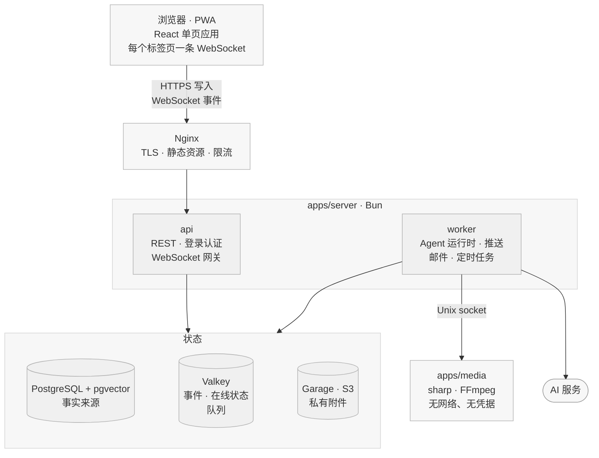

<p align="center">
  <a href="README.md">English</a> &nbsp;·&nbsp; <strong>简体中文</strong>
</p>

<p align="center">
  
</p>

<h1 align="center">ChatApp</h1>

<p align="center">
  邀请制的实时聊天社区，内置一个 Agent：<br>
  它只读你有权阅读的会话，动手之前先问你。
</p>

<p align="center">
  <a href="https://chatapp.software"><strong>打开 ChatApp ↗</strong></a> &nbsp;·&nbsp;
  <a href="docs/demo.zh-CN.md">产品导览</a> &nbsp;·&nbsp;
  <a href="#技术实现">技术实现</a> &nbsp;·&nbsp;
  <a href="#本地运行">本地运行</a> &nbsp;·&nbsp;
  <a href="docs/00-overview.md">文档</a>
</p>

<p align="center">
  <picture>
    <source media="(prefers-color-scheme: dark)" srcset="docs/assets/demo/zh-CN/03-agent-panel-dark.webp">
    
  </picture>
</p>

<p align="center">
  <sub>真实客户端、虚构人物、预设的回答：不调用任何 AI 服务，也不发送任何消息。图片会跟随你的 GitHub 主题切换。</sub>
</p>

ChatApp 是一个为千人以内的社区设计的实时聊天应用：频道、群组和私信，支持文件与媒体，可以在浏览器里使用，也可以安装成桌面应用。Agent 是内置的：它在你有权阅读的范围内帮你补齐进展、搜索、翻译和起草；经你批准具体的操作之后，还能代你发送或定时发送消息、建群、邀请成员。

它运行在 [chatapp.software](https://chatapp.software)，注册需要邀请码。代码以 MIT 许可开源，这个仓库包含源码、基础设施定义和运维工具，可以用来部署自己的实例。

## 会话

<p align="center">
  <picture>
    <source media="(prefers-color-scheme: dark)" srcset="docs/assets/demo/zh-CN/02-messages-dark.webp">
    
  </picture>
</p>

- **频道、群组和私信。** 频道可以发现和加入；群组是私有的，可以生成邀请链接。群主和管理员可以改名、移出、封禁、禁言和归档；置顶、免打扰和通知级别由每个成员自己决定。
- **好读的消息。** Markdown 与代码高亮、引用回复、@提及、表情面板。默认可在 24 小时内编辑、2 分钟内撤回。
- **文件与媒体。** 把文件拖到会话的任意位置，或者直接粘贴图片。图片在图库里查看，视频和音频就地播放，每个会话都能浏览其中分享过的文件。
- **处处同步。** 在线状态、正在输入、已读位置和未读数，在多个标签页和设备之间保持一致。断线重连后按同步日志补齐；断网时写下的消息，联网后自动发出。
- **搜索与通知。** <kbd>Ctrl / ⌘</kbd> + <kbd>K</kbd> 跳转会话、执行命令、按关键词搜索消息，全程不经过 AI。通知中心和可选的浏览器推送覆盖私信、@提及、回复和 Agent 的审批请求。
- **历史从加入那一刻开始。** 新成员只能看到自己加入之后的消息。引用、预览、搜索、附件和 Agent 都遵守同一条规则。

## 先问过你的 Agent

<p align="center">
  <picture>
    <source media="(prefers-color-scheme: dark)" srcset="docs/assets/demo/zh-CN/04-agent-approval-dark.webp">
    
  </picture>
</p>

- **就在你正在用的地方。** 会话旁的私有面板（<kbd>Ctrl / ⌘</kbd> + <kbd>J</kbd>）、专门的助手对话、在群组或频道里 `@助手`（回答全员可见），以及输入框里的 `/summary`、`/translate` 和 `/draft`。
- **先读，再帮忙。** 总结你没读的消息，按关键词或按语义找到一段讨论，翻译，起草回复，回答关于图片的问题。草稿只会放进你的输入框，发不发由你决定。
- **影响别人的事，先经你批准。** 代发消息、定时发送、建群、邀请成员，都会先停在一张卡片上，写明发到哪里、内容是什么。你可以批准、修改或拒绝。你要求的提醒和记忆会直接创建，界面上看得到，也可以撤销。
- **默认只读眼前的会话。** 面板默认只读当前会话，扩大到你的全部会话需要你明确选择。群里 `@助手` 的回答只使用全体现有成员都看得到的历史，也不带入你的个人记忆，所以别人埋在群里的话，没法把你的私聊内容引出来。
- **用站点的额度，或者用自己的密钥。** 可以用站点提供的额度，也可以填写自己的 DeepSeek API key。使用站点密钥的运行内容，管理员可在 30 天内审计；使用你自己密钥的运行，管理员只能看到元数据。
- **过程看得见。** 快速与深入两种模式；回复流式输出，可以停止，也可以重新生成；工具步骤可以展开查看；用量计入每日和每月的额度。

语义检索和图片理解取决于实例的配置。完整行为见 [Agent 设计](docs/06-agent.md)与[安全规范](docs/07-security.md)。

## 不抢戏的界面

<p align="center">
  
  
</p>

2026 年 11 月，客户端围绕一个想法重做了一遍：会话铺满窗口，导航作为玻璃悬浮在它上面。

- **玻璃用来导航，实底用来阅读。** 侧栏、工具栏的胶囊、输入栏和右侧面板是玻璃。消息列表始终是实底，文字从不落在壁纸上。
- **安静的颜色。** 米白的浅色主题和沉稳的深色主题；九种强调色按同一条 OKLCH 规则生成，只差色相、不差响度；透明度四档，字号五档。
- **对比度是量出来的。** 每次运行检查，都会核对约 2900 组文字、控件和焦点环的对比度，覆盖全部强调色、两种主题和每一档透明度。
- **动的东西都有来由。** 新消息从输入栏升起，菜单从打开它的控件里长出来，切换主题时新的样子从点击的位置扩散开。开启“减少动态效果”后，全部变成不超过 150 毫秒的淡入淡出。
- **键盘与读屏。** 所有功能都能在命令面板里找到，快捷键覆盖助手面板、切换会话和 Markdown 格式。浏览器测试包含无障碍扫描，时间线为读屏用户提供分页模式。
- **中英双语，可以安装。** 两种语言在同一个应用里；可以安装成桌面 PWA，图标上显示未读数。

其余的界面在[产品导览](docs/demo.zh-CN.md)里：会话详情、助手设置、命令面板、外观设置和窄窗口布局。每个取舍的理由写在[设计规范](docs/02-design-system.md)里。

## 社区与隐私

- **邀请制。** 成员邀请成员，默认每人五个名额；新账号验证邮箱之后才能登录。支持 Passkey，每个人都能查看并注销自己的登录设备。
- **管理。** 任何成员都可以举报消息。站点管理员管理成员、邀请、频道与群组、举报、AI 预算和审计日志。
- **把隐私说清楚。** 管理员不能读取自己不在其中的会话，只有两个例外，且每次查看都记入审计：被举报的消息及其前后各五条，以及使用站点密钥的 Agent 运行内容。本项目不提供端到端加密，运营服务器的人在技术上可以读到其中的数据。应用内的隐私说明页写的是同样的内容。

## 技术实现



- **写操作走 HTTP，事件走 WebSocket。** 所有改变状态的操作都是带幂等键的 HTTP 请求。WebSocket 只传提示，以及“正在输入”“在线状态”这类瞬时信号，不带消息正文。
- **规则只在一处。** 路由、WebSocket 网关、Agent 工具和后台任务都很薄。业务逻辑、授权和可见性集中在 `apps/server/src/domain/`；无权查看的私有资源返回 404，与不存在的资源完全一样。
- **PostgreSQL 是事实来源。** 一次业务变更、它的同步日志和由它触发的后台工作，在同一个事务里提交。队列和事件总线可以据此重建，客户端按日志对账。
- **可见性只有一条规则。** 当前成员，只读自己加入之后的内容。消息、引用、预览、搜索、附件和 Agent 的每一次读取都走同一个检查，Agent 的流式输出逐批重新授权。
- **不可信的媒体关在盒子里。** 解码在没有网络、没有业务凭据的独立容器里进行，worker 只通过 Unix socket 把字节交给它。
- **删除经得起恢复。** 在生产环境，删除先写入异地 journal 才算确认；恢复时先重放这份 journal，备份不会让已删除的内容复活。
- **做不到的不承诺。** 模型调用、邮件和推送都不保证恰好一次。结果未知的调用会被记录并计入预算，不会盲目重试。

| 层 | 使用的技术 |
| --- | --- |
| 前端 | React 19 与 React Compiler · Vite 8 · TanStack Router / Query · Tailwind CSS 4 · Base UI · Motion · Streamdown 与 Shiki · Paraglide · Workbox |
| 后端 | Bun 1.4 · Hono · Zod 4 · Drizzle ORM · Better Auth 与 Passkey · BullMQ · AI SDK 7 |
| 数据 | PostgreSQL 18 与 pgvector · Valkey 9 · Garage（兼容 S3） |
| 媒体 | sharp 与 FFmpeg，运行在没有网络的容器里 |
| 质量 | 严格模式的 TypeScript 7 · Biome · Bun test 与 Vitest · Playwright 与 axe · Storybook 10 · k6 |
| 运维 | Docker Compose · Nginx · systemd 定时器 · restic 备份 |

精确版本以各工作区的 `package.json`、`bun.lock` 和 `infra/` 下的文件为准。更深入的内容见[架构](docs/03-architecture.md)、[数据模型](docs/04-data-model.md)和[接口与实时协议](docs/05-api-and-realtime.md)。

## 本地运行

需要 Bun 1.4.2、Node.js 24 或更新版本，以及带 Compose 的 Docker。Windows 上请在 WSL 里操作，并把仓库放在 Linux 文件系统中。

```bash
git clone https://github.com/liaboveall/ChatApp.git
cd ChatApp
bun install --frozen-lockfile
bun run setup            # 生成 .env.local 和随机密钥
bun run infra:up         # PostgreSQL、Valkey、Garage 和 Mailpit
bun run infra:bootstrap  # 准备对象存储
bun run db:migrate
bun run db:seed          # 三个演示成员和几个会话
bun run admin:create --email you@example.com --username you --name "你的名字"
bun run dev
```

`admin:create` 会在终端里要求输入管理员密码。打开 `[dev] Open` 后面显示的地址，通常是 `http://localhost:5173`。开发环境发出的邮件在 Mailpit 里查看：`http://localhost:8025`。演示成员是 `alice`、`bob` 和 `carol`（邮箱在 `example.test` 下），密码是 `.env.local` 里的 `SEED_DEMO_PASSWORD`。

不配置 AI 也能聊天。要使用 Agent，在 `.env.local` 里填入所选服务的密钥，再运行 `bun run doctor --ai`；默认服务是 NUS SoCLaaS 网关，设置 `AI_PROVIDER=deepseek` 则改用 DeepSeek。`bun run doctor` 诊断环境的其余部分。更多内容见[本地开发](docs/09-local-dev.md)；生产环境使用独立的配置和发布包，见[部署指南](docs/10-deployment.md)。

## 检查与测试

| 命令 | 覆盖范围 |
| --- | --- |
| `bun run check` | 格式与 lint、类型、架构与密钥边界、单元测试、对比度、双语文案 |
| `bun run build` | 生产客户端及其 Service Worker |
| `bun run test:integration` | 集成、安全、契约和实时套件，使用真实的 PostgreSQL、Valkey 和 Garage |
| `bun run test:e2e` | 浏览器场景，使用真实的本地服务，在 Chromium、WebKit 和 Firefox 上运行 |
| `bun run test:review` | 浏览器里的组件回归，使用合成的 HTTP 数据 |
| `bun run test:visual` | Storybook 截图基线，在官方 Playwright 容器内运行 |
| `bun run storybook` | 组件开发与预览 |
| `bun run demo:capture` | 本页的截图，两种主题各一套；加 `--locale=zh-CN` 拍中文版 |

前两项不需要启动任何服务，其余需要开发基础设施；共享测试库的套件要串行运行。每次向 `main` 推送或发起拉取请求，都会运行七个 GitHub Actions 工作流：check、integration、e2e、media、embeddings、images 和 security；针对真实模型的评测需要手动触发。完整清单见[测试指南](docs/08-testing.md)。

## 仓库结构

```text
apps/web/            React 客户端与 PWA、Storybook、浏览器与视觉测试
apps/server/         API、WebSocket 网关、worker、Agent 运行时、管理 CLI、评测
apps/media/          不联网的媒体运行时
packages/contracts/  前后端共用的 Zod schema：DTO、事件、限额
packages/db/         Drizzle schema、迁移、初始化与开发种子
infra/               Compose 文件、镜像、Nginx 与 systemd 模板、压测脚本
scripts/             开发、测试、发布、备份与诊断工具
docs/                规格、指南与产品导览
```

## 文档

| 文档 | 内容 |
| --- | --- |
| [产品导览](docs/demo.zh-CN.md) | 十张图看完整个应用，以及重拍的方法 |
| [产品规格](docs/01-product-spec.md) | 聊天、Agent、管理、隐私与默认值 |
| [设计规范](docs/02-design-system.md) | 玻璃、令牌、布局、动效与组件 |
| [架构](docs/03-architecture.md) | 分层、数据流、实时同步与后台任务 |
| [数据模型](docs/04-data-model.md) | 表、不变量、迁移与保留期 |
| [接口与实时协议](docs/05-api-and-realtime.md) | REST、DTO、WebSocket 与同步契约 |
| [Agent 设计](docs/06-agent.md) | 工具、读取范围、审批、上下文与评测 |
| [安全规范](docs/07-security.md) | 威胁模型、安全要求与回归 |
| [本地开发](docs/09-local-dev.md) · [测试指南](docs/08-testing.md) | 环境、服务与全部测试套件 |
| [部署指南](docs/10-deployment.md) · [运维命令](docs/operations.md) | 发布包、更新、备份与恢复 |
| [维护原则](docs/12-decisions.md) · [维护记录](docs/maintenance.md) | 仍需遵守的约束，以及每次改动的记录 |

README 与产品导览提供中英文两个版本，工程文档以中文撰写。

## 还没有做的

桌面优先：窄窗口会重排成单栏，但手机上的手势还没有做。表情回应、置顶消息、话题线程、转发、链接预览、语音消息、Agent 联网搜索和 MCP 工具计划在之后的版本里做。音视频通话、端到端加密和阅后即焚不在计划之内。

## 历史与许可

`main` 是当前维护的主线，原名 `v2`。最初的版本是一个 Django + Channels 应用，改编自 [rustyxlol/Django-ChatApp](https://github.com/rustyxlol/Django-ChatApp)，保存在 [`archive/v1`](https://github.com/liaboveall/ChatApp/tree/archive/v1) 和 [`v1-legacy`](https://github.com/liaboveall/ChatApp/tree/v1-legacy)。重写阶段的规划、评审和原型保存在 [`v2-pre-cleanup-2026-10-20`](https://github.com/liaboveall/ChatApp/tree/v2-pre-cleanup-2026-10-20)。

以 [MIT 许可](LICENSE)发布，许可证中保留了原作者的版权声明。
