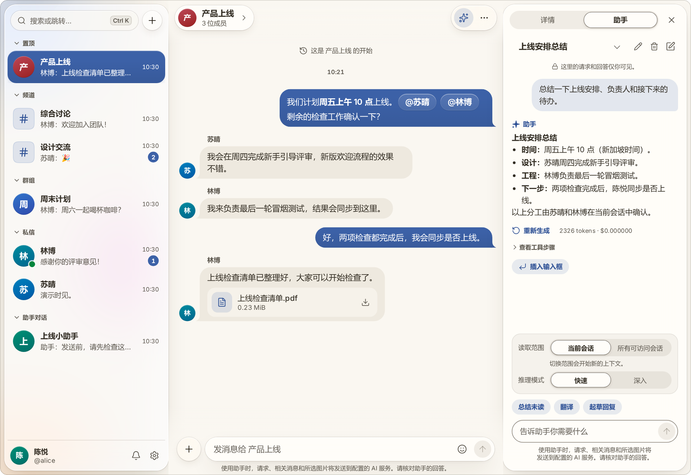
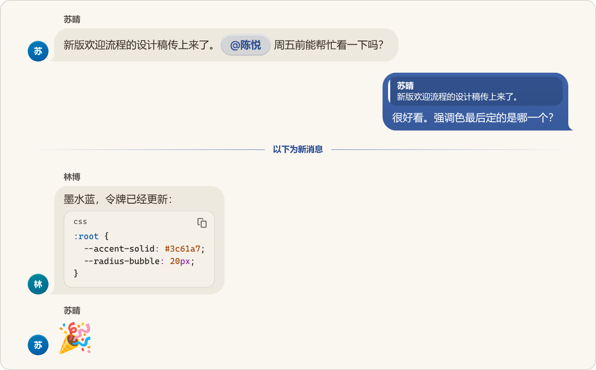
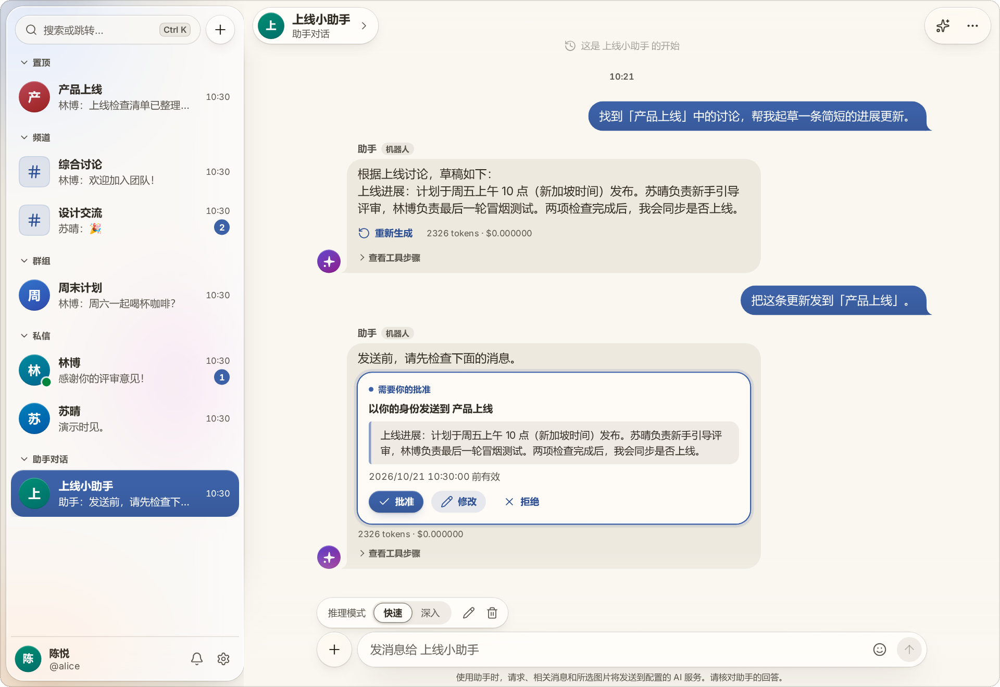
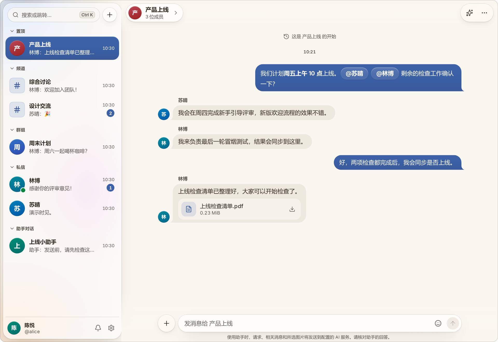
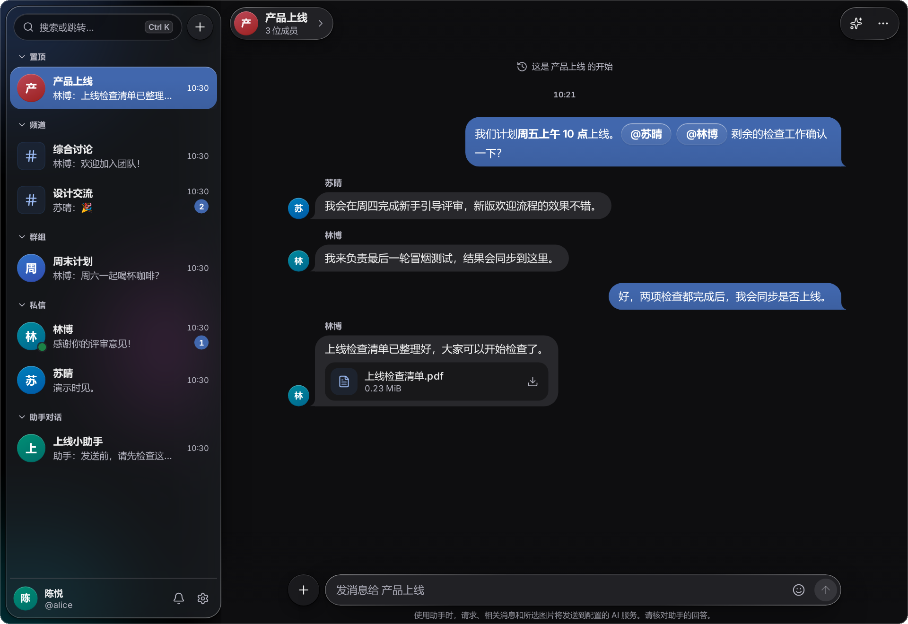
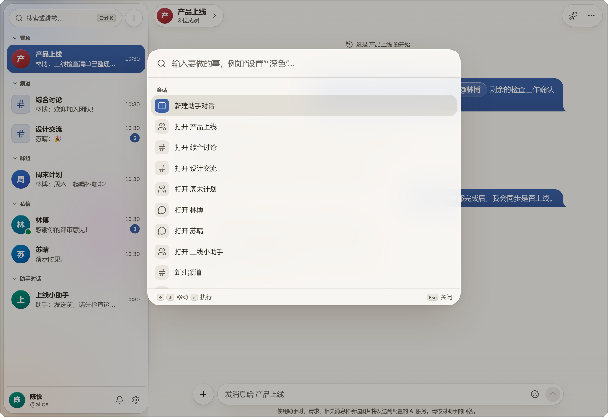
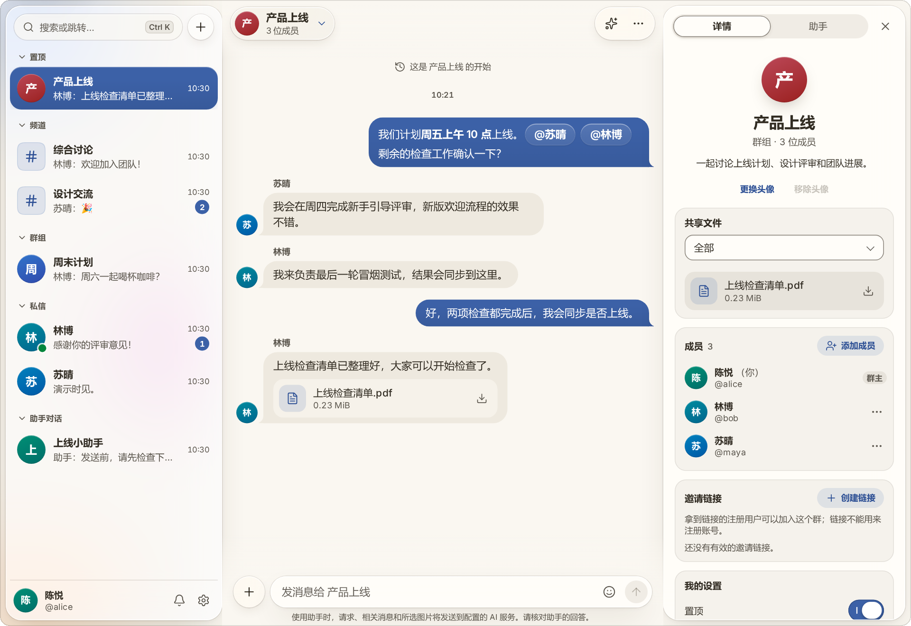
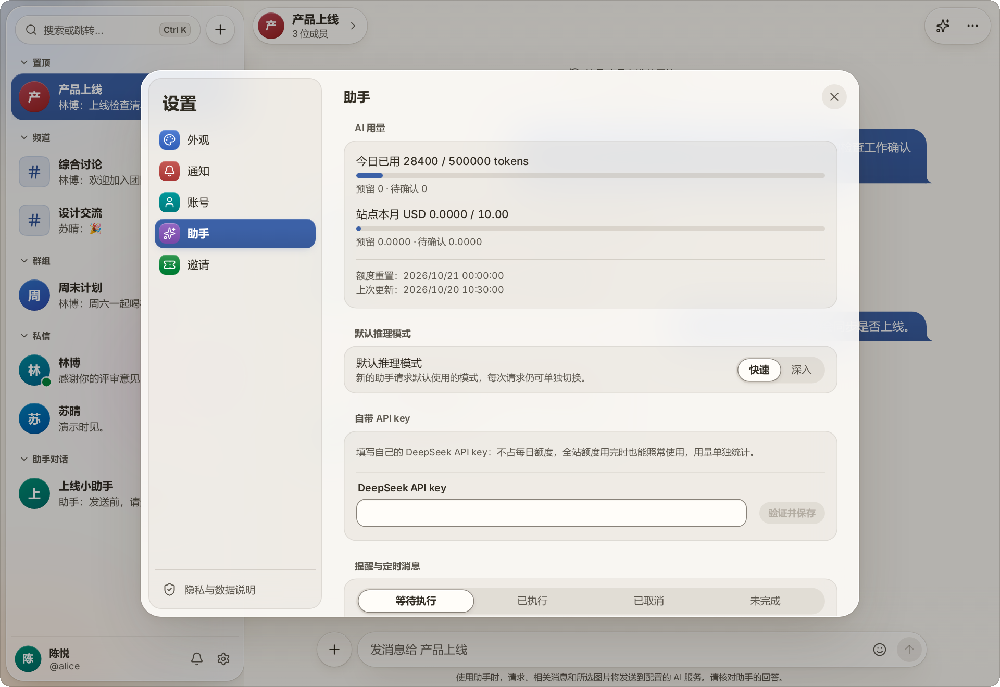
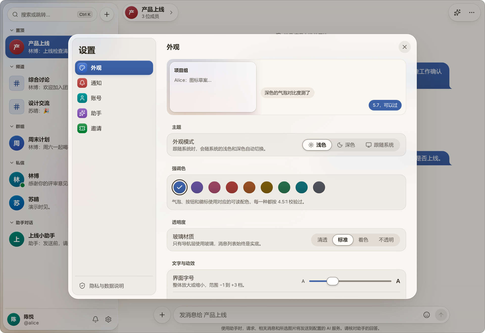

<p align="center">
  <a href="README.md">English</a> &nbsp;·&nbsp; <strong>简体中文</strong>
</p>

<p align="center">
  
</p>

<h1 align="center">ChatApp</h1>

<p align="center">
  邀请制的实时聊天社区，内置一个 Agent：<br>
  它只读你有权阅读的会话，动手之前先问你。
</p>

<p align="center">
  <a href="https://chatapp.software"><strong>打开 ChatApp ↗</strong></a> &nbsp;·&nbsp;
  <a href="docs/demo.zh-CN.md">产品导览</a> &nbsp;·&nbsp;
  <a href="#本地运行">本地运行</a> &nbsp;·&nbsp;
  <a href="docs/00-overview.md">文档</a>
</p>

<p align="center">
  <picture>
    <source media="(prefers-color-scheme: dark)" srcset="docs/assets/demo/zh-CN/03-agent-panel-dark.webp">
    
  </picture>
</p>

<p align="center">
  <sub>截图来自真实客户端，人物和对话是虚构的。图片会跟随你的 GitHub 主题。</sub>
</p>

<h2 align="center">聊天该有的，都在这里</h2>

<p align="center">
  频道、群组和私信；引用回复、@提及、Markdown 与代码高亮。<br>
  图片、音视频和文件就地查看，多个设备之间实时同步。
</p>

<p align="center">
  <picture>
    <source media="(prefers-color-scheme: dark)" srcset="docs/assets/demo/zh-CN/02-messages-dark.webp">
    
  </picture>
</p>

<h2 align="center">先问过你，再动手的 Agent</h2>

<p align="center">
  它只读你有权阅读的会话，帮你总结未读、搜索、翻译和起草。<br>
  要代你发消息、建群或邀请成员时，它先把目标和内容摆出来，等你批准、修改或拒绝。
</p>

<p align="center">
  <picture>
    <source media="(prefers-color-scheme: dark)" srcset="docs/assets/demo/zh-CN/04-agent-approval-dark.webp">
    
  </picture>
</p>

<h2 align="center">不抢戏的界面</h2>

<p align="center">
  会话铺满窗口，导航是悬浮在上面的玻璃。<br>
  浅色与深色、九种强调色、四档透明度，每一种组合的对比度都校验过。
</p>

<p align="center">
  
  
</p>

<h2 align="center">还有这些</h2>

<p align="center">
  命令面板、成员与文件，还有属于你自己的助手和外观。
</p>

<p align="center">
  <picture>
    <source media="(prefers-color-scheme: dark)" srcset="docs/assets/demo/zh-CN/08-command-palette-dark.webp">
    
  </picture>
  <picture>
    <source media="(prefers-color-scheme: dark)" srcset="docs/assets/demo/zh-CN/06-details-dark.webp">
    
  </picture>
</p>

<p align="center">
  <picture>
    <source media="(prefers-color-scheme: dark)" srcset="docs/assets/demo/zh-CN/07-assistant-settings-dark.webp">
    
  </picture>
  <picture>
    <source media="(prefers-color-scheme: dark)" srcset="docs/assets/demo/zh-CN/09-appearance-dark.webp">
    
  </picture>
</p>

<p align="center">
  <strong>邀请制</strong> &nbsp;·&nbsp;
  <strong>Passkey 登录</strong> &nbsp;·&nbsp;
  <strong>中英双语</strong> &nbsp;·&nbsp;
  <strong>可以装成桌面应用</strong> &nbsp;·&nbsp;
  <a href="docs/01-product-spec.md#411-隐私与数据说明">隐私边界写在明处</a>
</p>

<p align="center">
  <a href="docs/demo.zh-CN.md"><strong>十张图看完整个应用 →</strong></a>
</p>

<p align="center">
  <sub>ChatApp 运行在 <a href="https://chatapp.software">chatapp.software</a>，注册需要邀请码；用这个仓库也可以部署一个自己的实例。</sub>
</p>

## 本地运行

需要 Bun 1.4.2、Node.js 24 或更新版本，以及带 Compose 的 Docker。Windows 上请在 WSL 里操作。

```bash
git clone https://github.com/liaboveall/ChatApp.git
cd ChatApp
bun install --frozen-lockfile
bun run setup            # 生成 .env.local 和随机密钥
bun run infra:up         # PostgreSQL、Valkey、Garage 和 Mailpit
bun run infra:bootstrap  # 准备对象存储
bun run db:migrate
bun run db:seed          # 三个演示成员和几个会话
bun run admin:create --email you@example.com --username you --name "你的名字"
bun run dev              # 打开终端里 [dev] Open 后面的地址
```

不配置 AI 也能聊天。Agent 的配置、测试和部署，见[本地开发](docs/09-local-dev.md)、[测试指南](docs/08-testing.md)和[部署指南](docs/10-deployment.md)。

## 技术与文档

React 19 · Vite · Tailwind CSS 4 · Bun · Hono · PostgreSQL 与 pgvector · Valkey · Garage · Docker Compose

[架构](docs/03-architecture.md) · [Agent 设计](docs/06-agent.md) · [设计规范](docs/02-design-system.md) · [安全规范](docs/07-security.md) · [产品规格](docs/01-product-spec.md) · [全部文档](docs/00-overview.md)

以 [MIT 许可](LICENSE)发布。最初的 Django 版本改编自 [rustyxlol/Django-ChatApp](https://github.com/rustyxlol/Django-ChatApp)，保存在 [`archive/v1`](https://github.com/liaboveall/ChatApp/tree/archive/v1)。
