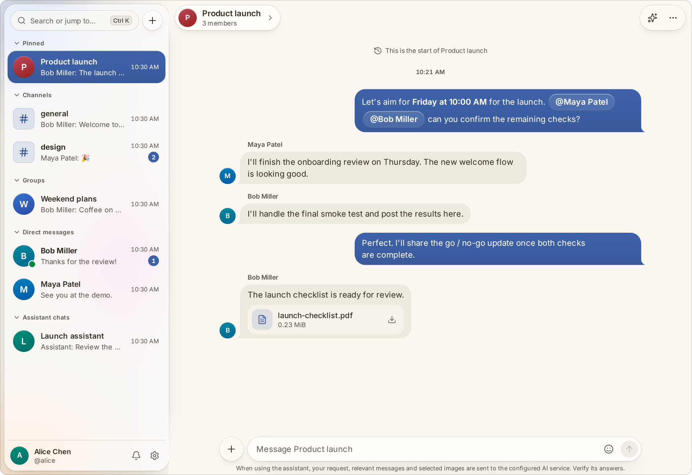
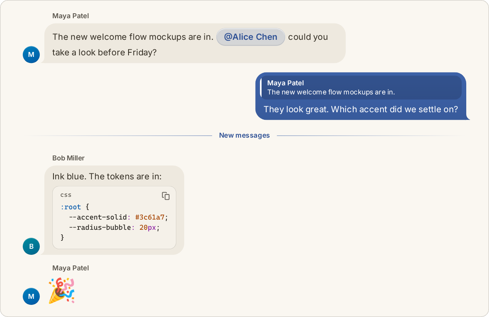
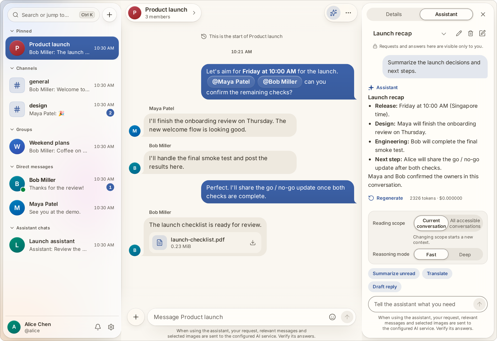
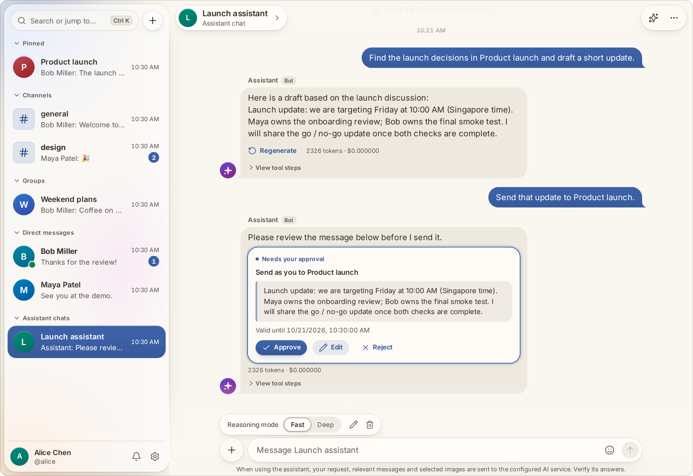
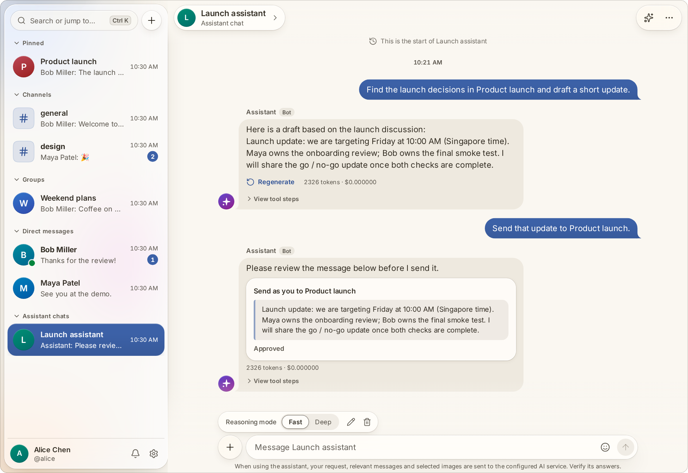
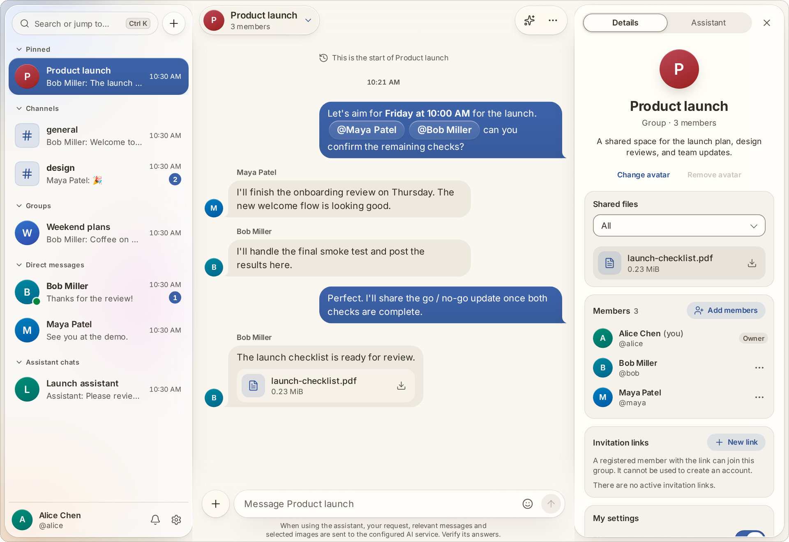
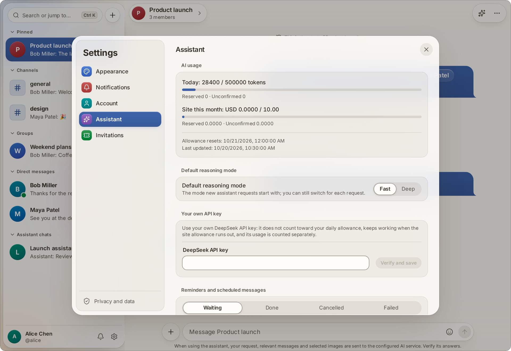
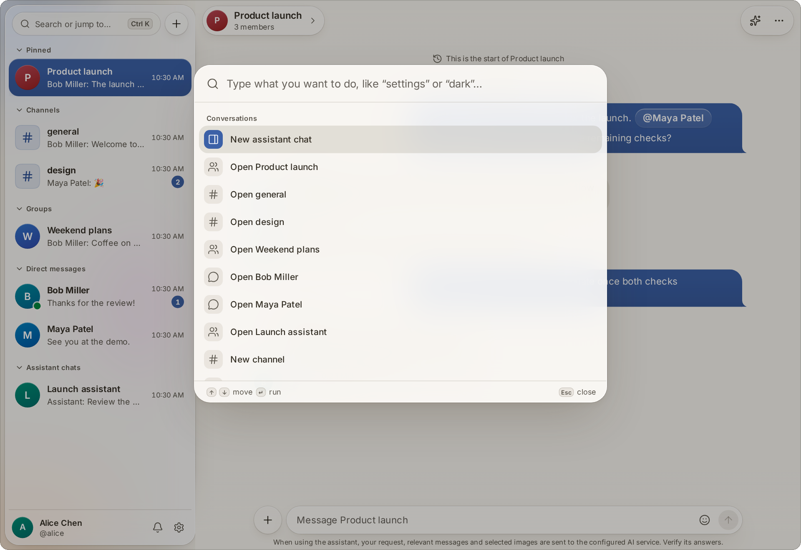
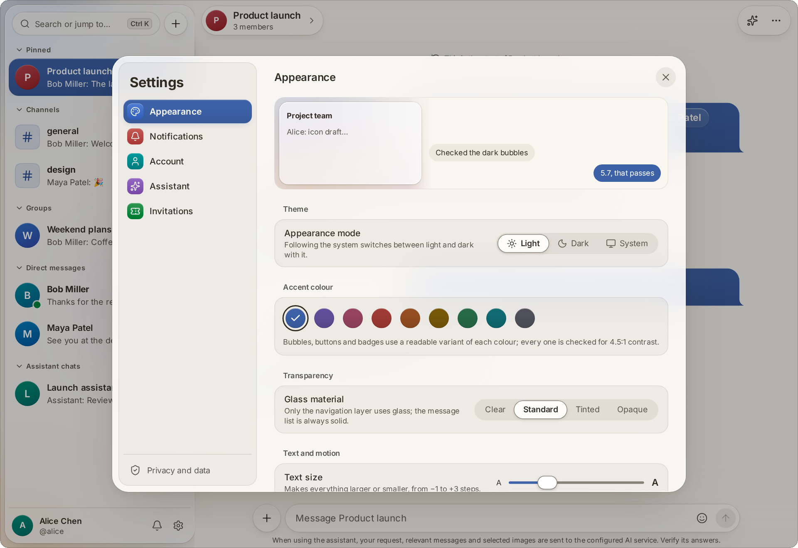
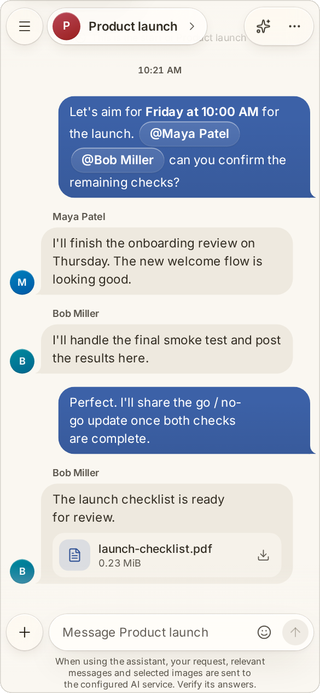

# ChatApp product tour

**English** · [简体中文](demo.zh-CN.md)

[Back to the README](../README.md) · [Open ChatApp](https://chatapp.software)

A walkthrough of the English application in ten pictures: discuss a launch, share a file, catch up with the Agent, and review an action before it happens.

The pictures are captured from the actual web client using fictional people and browser-local API and WebSocket responses. Agent answers and approval outcomes are scripted presentation fixtures. No real accounts, private conversations, provider credentials, AI calls, or message deliveries are involved. Every picture exists in the light and the dark theme, and the page shows the one that matches your GitHub theme.

## 1. A home for the conversation

Channels, private groups, direct messages, and assistant chats live in the sidebar. Pinned conversations stay at the top; unread badges help you find what needs attention.

In **Product launch**, Alice mentions Maya and Bob to agree on a release time, they assign the remaining checks, and Bob shares `launch-checklist.pdf`. Markdown, mentions, file cards, and the composer are part of the same conversation.

<p>
  <picture>
    <source media="(prefers-color-scheme: dark)" srcset="assets/demo/01-workspace-dark.webp">
    
  </picture>
</p>

The conversation fills the window. The sidebar, the title and tool capsules at the top, and the composer at the bottom are glass floating over it.

Try it in your own workspace: create a group, invite teammates, and drop a file anywhere in the conversation. New members see messages from the point at which they join.

## 2. Messages, up close

This is the **design** channel. Maya mentions Alice, so that mention is tinted more strongly than one of somebody else would be. Alice answers with a quoted reply. The line marks where the messages she has not read begin. Bob's code block is highlighted, names its language, and has a copy button. A message that is only an emoji is shown large, without a bubble.

<p>
  <picture>
    <source media="(prefers-color-scheme: dark)" srcset="assets/demo/02-messages-dark.webp">
    
  </picture>
</p>

Hover over a message for its time and for reply and more actions; the context menu also offers copy, edit, recall, delete for yourself, report, and handing the message to the assistant.

## 3. Catch up with the Agent beside your chat

Open the **Assistant** panel from the toolbar. It stays beside the discussion, so the source conversation remains visible while you read a private answer.

The panel offers **Summarize unread**, **Translate**, and **Draft reply**. You can choose **Fast** or **Deep**, keep separate assistant histories, and insert an answer into the conversation composer for review before sending.

> Summarize the launch decisions and next steps.

<p>
  <picture>
    <source media="(prefers-color-scheme: dark)" srcset="assets/demo/03-agent-panel-dark.webp">
    
  </picture>
</p>

**Current conversation** is the default reading scope. Choose **All accessible conversations** explicitly when you want broader context. For a shared answer, mention `@Agent` in a group or channel; it uses that conversation's shared visible history.

## 4. Find context, draft, then review an action

A dedicated assistant chat gives you a private place to work across conversations you can access.

> Find the launch decisions in Product launch and draft a short update.
>
> Send that update to Product launch.

The Agent prepares a draft, then presents the proposed send with the destination and exact text. **Approve**, **Edit**, and **Reject** keep the decision with you. Sending and scheduling messages, creating groups, and inviting members require approval.

<p>
  <picture>
    <source media="(prefers-color-scheme: dark)" srcset="assets/demo/04-agent-approval-dark.webp">
    
  </picture>
</p>

The next capture shows the card after Alice selects **Approve**. In this tour, the response is simulated; it illustrates the approval state without delivering a message.

<p>
  <picture>
    <source media="(prefers-color-scheme: dark)" srcset="assets/demo/05-agent-approved-dark.webp">
    
  </picture>
</p>

Open **View tool steps** in an assistant reply to inspect its tool activity. Responses stream as they are generated; you can stop a running response or regenerate an eligible completed reply.

## 5. Keep files and people within reach

Select the title capsule in the toolbar, **Members and details**. The details panel brings together shared files, members, invitation links, your notification preferences, and the conversation controls available to your role.

<p>
  <picture>
    <source media="(prefers-color-scheme: dark)" srcset="assets/demo/06-details-dark.webp">
    
  </picture>
</p>

Image previews, video and audio playback, file downloads, drag-and-drop uploads, and avatar editing are also available. This scene demonstrates a PDF file card; it does not demonstrate uploading or playing media.

## 6. Make the assistant personal

Open **Settings → Assistant** to choose a default reasoning mode, configure your own DeepSeek API key, review usage, and manage personal memories, reminders, and scheduled messages.

<p>
  <picture>
    <source media="(prefers-color-scheme: dark)" srcset="assets/demo/07-assistant-settings-dark.webp">
    
  </picture>
</p>

Example requests to try when AI is configured:

- “Remind me tomorrow at 9 AM to check the launch results.”
- “Remember that I prefer concise updates with an owner for each next step.”
- “Schedule this message for Friday at 10 AM in Asia/Singapore.”
- “Find the discussion about onboarding, even if it used different wording.”
- “Translate the latest message into English.”
- Attach an image and ask, “What changed in this design?”

Personal reminders and explicitly requested memories can be created directly with visible results and undo controls. Time-based actions show the date and time zone. Semantic search needs embeddings, and image understanding needs a compatible configured model. These prompts describe available workflows; this screenshot tour does not execute them against an AI provider.

## 7. Navigate from the keyboard

Use **Ctrl+K** on Windows/Linux or **⌘K** on macOS to open the command palette. Jump to conversations, search messages, create chats, or open settings. Keyword message search does not use AI tokens.

<p>
  <picture>
    <source media="(prefers-color-scheme: dark)" srcset="assets/demo/08-command-palette-dark.webp">
    
  </picture>
</p>

Use **Ctrl+J / ⌘J** to toggle the assistant panel, and **Ctrl+B / I / Shift+X** in the composer for bold, italic, and strikethrough. Open the shortcut reference from the toolbar menu for the complete list.

## 8. Choose your appearance

**Settings → Appearance** holds the choices that belong to a device: light, dark, or following the system; nine accent colors; four levels of glass transparency from **Clear** to **Opaque**; text size; reduced motion; and whether the sidebar shows message previews. The preview at the top changes as you choose. English and Chinese are available in the same application, and the desktop PWA can be installed from a supporting browser.

<p>
  <picture>
    <source media="(prefers-color-scheme: dark)" srcset="assets/demo/09-appearance-dark.webp">
    
  </picture>
</p>

Each accent is checked for contrast in both themes, and only the navigation layer uses glass; the message list is always solid.

## 9. Narrow windows

The app also reflows into a single conversation column at narrower widths, with navigation available in a drawer. The desktop remains the primary experience.

<p>
  <picture>
    <source media="(prefers-color-scheme: dark)" srcset="assets/demo/10-narrow-layout-dark.webp">
    
  </picture>
</p>

## Recreate the pictures

From the repository root, after installing dependencies:

```bash
bun x playwright install chromium
bun run demo:capture
# Chinese UI and demo content
bun run demo:capture --locale=zh-CN
```

The capture script starts the real Vite client on `127.0.0.1:25178`, intercepts API and WebSocket traffic with localized fixtures, walks through the ten scenes once in the light theme and once in the dark theme, and stops its server. Run each language separately; the port must be free. It checks fixture contracts, visible text for the selected language, the approval interaction in both themes, dialog dismissal, browser runtime errors, unexpected API requests, and horizontal overflow at 390 pixels.

The window is 1280 by 880 CSS pixels (390 by 844 for the narrow layout) at 1.5 device pixels per CSS pixel, and the browser's clock is held at the moment of the fixtures. The second picture is a part of the window; the others are the whole of it. Each capture gets the corners of a window and a one-pixel edge, because it is shown on a page that is not the window's own color, and is written as lossless WebP: lossy encoding turns the soft lights under the glass into bands. English pictures are in `docs/assets/demo/` and Chinese ones in its `zh-CN/` directory, named `<scene>-<theme>.webp`. Local reports follow the same language directory layout in `.test-runs/readme-demo/`; failed attempts are retained separately.

The interface draws Chinese text and code in fonts of the machine it runs on, so a capture made elsewhere can differ in those glyphs.

The source is in [`capture-readme.ts`](../apps/web/tools/capture-readme.ts) and [`readme-fixtures.ts`](../apps/web/tools/readme-fixtures.ts). These tools are outside the production client entry points.

This is product presentation evidence. Real backend, model quality, media uploads, push delivery, device behavior, and deployment acceptance are covered separately by the [testing guide](08-testing.md).
