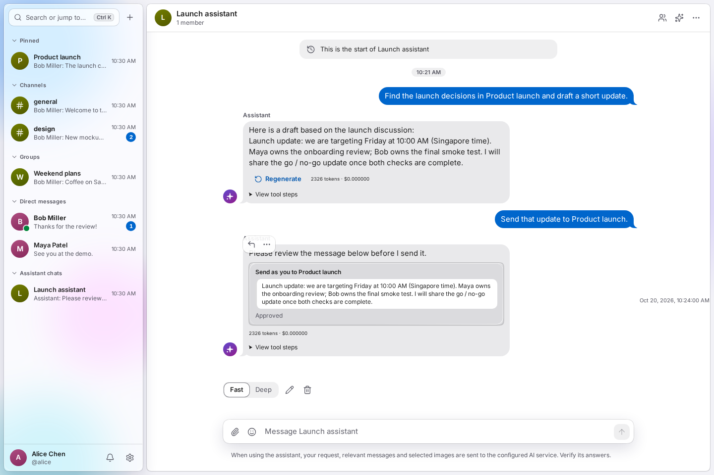
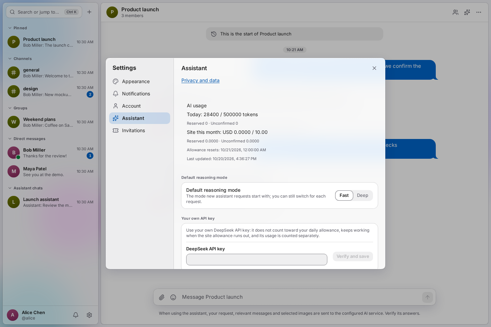
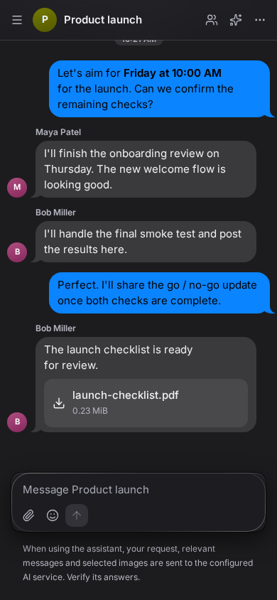

# ChatApp product tour

[Back to the README](../README.md) · [Open ChatApp](https://chatapp.software)

A walkthrough of the English application: discuss a launch, share a file, catch up with the Agent, and review an action before it happens.

The screenshots below are captured from the actual web client using fictional people and browser-local API and WebSocket responses. Agent answers and approval outcomes are scripted presentation fixtures. No real accounts, private conversations, provider credentials, AI calls, or message deliveries are involved.

## 1. A home for the conversation

Channels, private groups, direct messages, and assistant chats live in the sidebar. Pinned conversations stay at the top; unread badges help you find what needs attention.

In **Product launch**, Alice, Maya, and Bob agree on a release time, assign the remaining checks, and share `launch-checklist.pdf`. Markdown, file cards, and the composer are part of the same conversation.


Try it in your own workspace: create a group, invite teammates, and drag a file into the composer. New members see messages from the point at which they join.

## 2. Catch up with the Agent beside your chat

Open the **Assistant** panel from the toolbar. It stays beside the discussion, so the source conversation remains visible while you read a private answer.

The panel offers **Summarize unread**, **Translate**, and **Draft reply**. You can choose **Fast** or **Deep**, keep separate assistant histories, and insert an answer into the conversation composer for review before sending.

> Summarize the launch decisions and next steps.


**Current conversation** is the default reading scope. Choose **All accessible conversations** explicitly when you want broader context. For a shared answer, mention `@Agent` in a group or channel; it uses that conversation's shared visible history.

## 3. Find context, draft, then review an action

A dedicated assistant chat gives you a private place to work across conversations you can access.

> Find the launch decisions in Product launch and draft a short update.
>
> Send that update to Product launch.

The Agent prepares a draft, then presents the proposed send with the destination and exact text. **Approve**, **Edit**, and **Reject** keep the decision with you. Sending and scheduling messages, creating groups, and inviting members require approval.


The next capture shows the card after Alice selects **Approve**. In this tour, the response is simulated; it illustrates the approval state without delivering a message.



Open **View tool steps** in an assistant reply to inspect its tool activity. Responses stream as they are generated; you can stop a running response or regenerate an eligible completed reply.

## 4. Keep files and people within reach

Open **Members and details** in the conversation toolbar. The details panel brings together shared files, members, invitation links, your notification preferences, and the conversation controls available to your role.


Image previews, video and audio playback, file downloads, drag-and-drop uploads, and avatar editing are also available. This scene demonstrates a PDF file card; it does not demonstrate uploading or playing media.

## 5. Make the assistant personal

Open **Settings → Assistant** to choose a default reasoning mode, configure your own DeepSeek API key, review usage, and manage personal memories, reminders, and scheduled messages.



Example requests to try when AI is configured:

- “Remind me tomorrow at 9 AM to check the launch results.”
- “Remember that I prefer concise updates with an owner for each next step.”
- “Schedule this message for Friday at 10 AM in Asia/Singapore.”
- “Find the discussion about onboarding, even if it used different wording.”
- “Translate the latest message into English.”
- Attach an image and ask, “What changed in this design?”

Personal reminders and explicitly requested memories can be created directly with visible results and undo controls. Time-based actions show the date and time zone. Semantic search needs embeddings, and image understanding needs a compatible configured model. These prompts describe available workflows; this screenshot tour does not execute them against an AI provider.

## 6. Navigate from the keyboard

Use **Ctrl+K** on Windows/Linux or **⌘K** on macOS to open the command palette. Jump to conversations, search messages, create chats, or open settings. Keyword message search does not use AI tokens.


Use **Ctrl+J / ⌘J** to toggle the assistant panel. Open the shortcut reference from the toolbar menu for the complete list.

## 7. Choose your appearance

Light and dark themes, accent colors, glass intensity, text size, and reduced motion are device preferences. English and Chinese are available in the same application. The desktop PWA can be installed from a supporting browser.


The app also reflows into a single conversation column at narrower widths, with navigation available in a drawer. The desktop remains the primary experience.



## Recreate the screenshots

From the repository root, after installing dependencies:

```bash
bun x playwright install chromium
bun run demo:capture
```

The capture script starts the real Vite client on `127.0.0.1:25178`, intercepts API and WebSocket traffic with English fixtures, takes nine screenshots, and stops its server. The port must be free. It checks fixture contracts, visible text for Chinese characters, approval interaction, dialog dismissal, browser runtime errors, unexpected API requests, and horizontal overflow at 390 pixels. It writes a local report to `.test-runs/readme-demo/capture.json`; failed attempts are retained separately.

The source is in [`capture-readme.ts`](../apps/web/tools/capture-readme.ts) and [`readme-fixtures.ts`](../apps/web/tools/readme-fixtures.ts). These tools are outside the production client entry points. The animated overview is a slideshow of the captured states, with its frame order and timing in [`tour.json`](assets/demo/tour.json). After refreshing the screenshots, rebuild it with `python3 scripts/render-readme-tour.py` (requires Pillow).

This is product presentation evidence. Real backend, model quality, media uploads, push delivery, device behavior, and deployment acceptance are covered separately by the [testing guide](08-testing.md).
