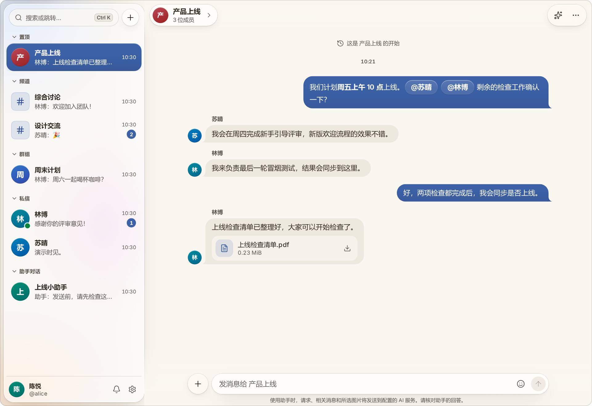
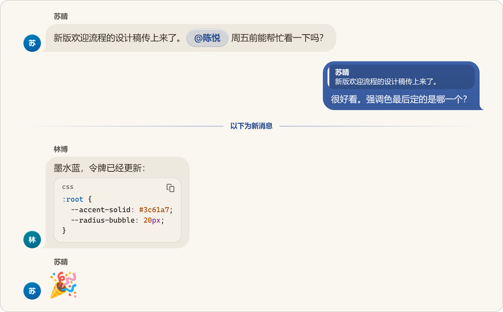
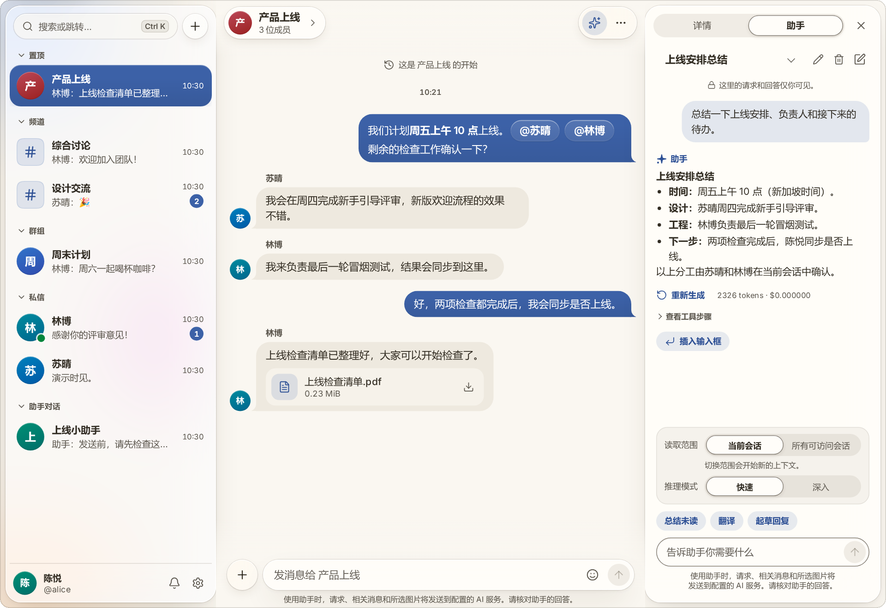
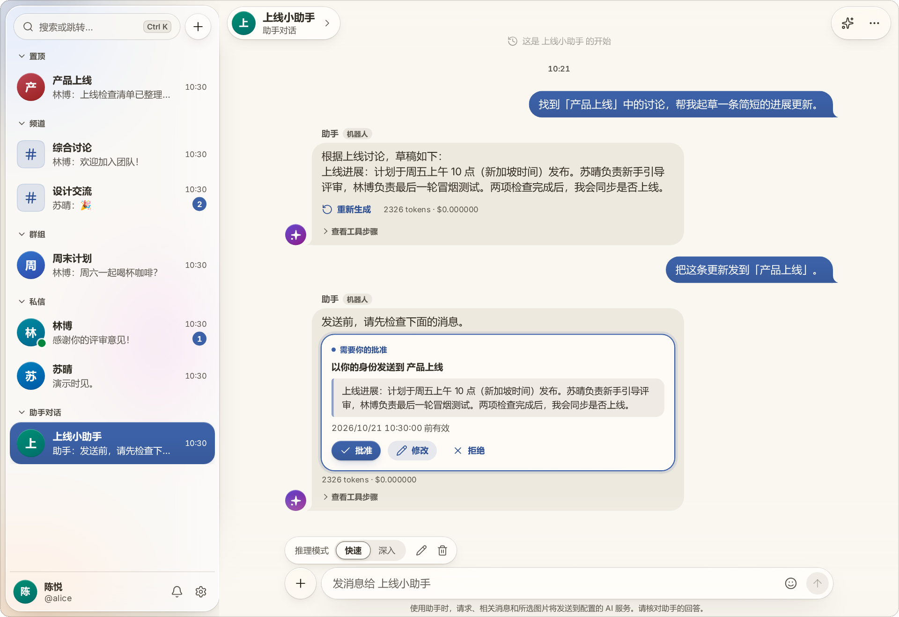
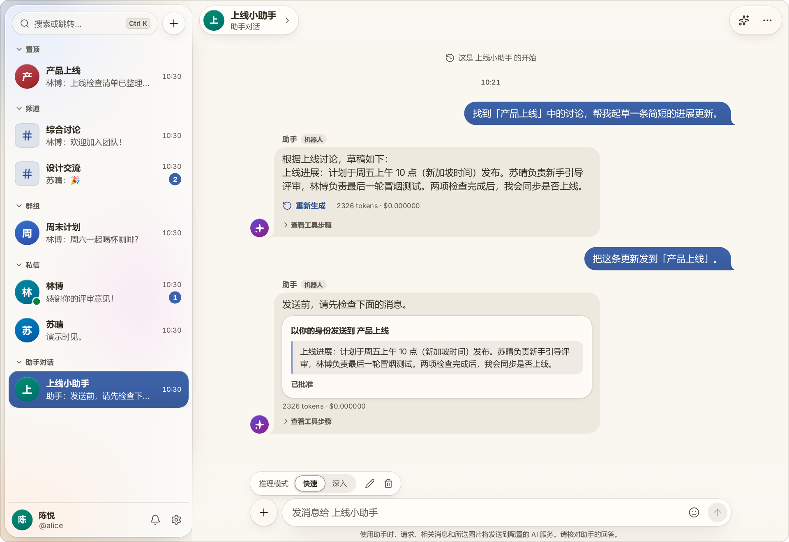
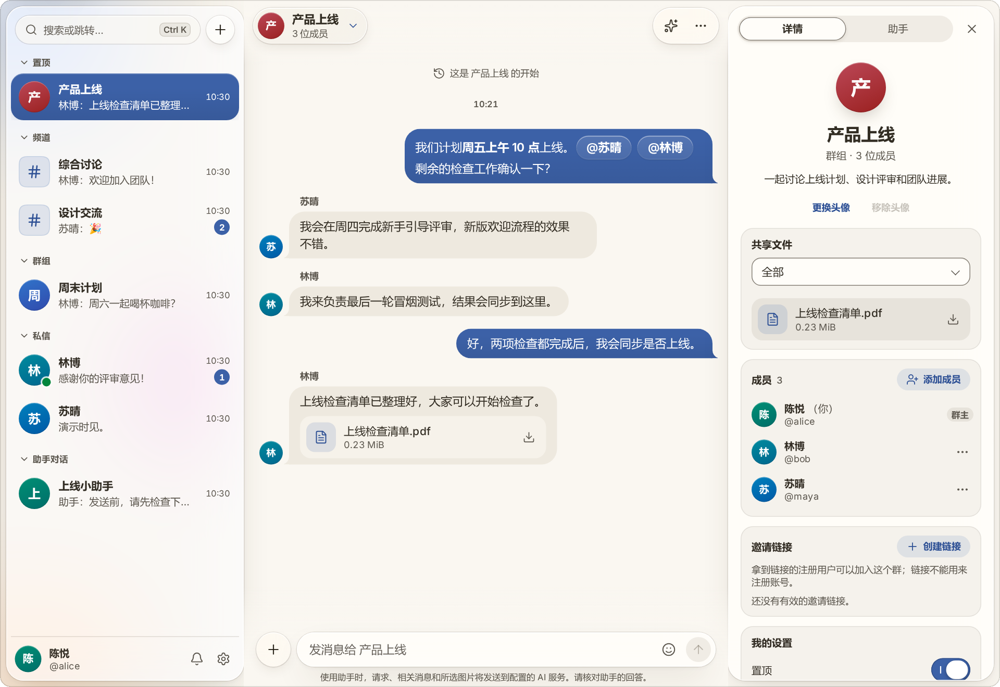
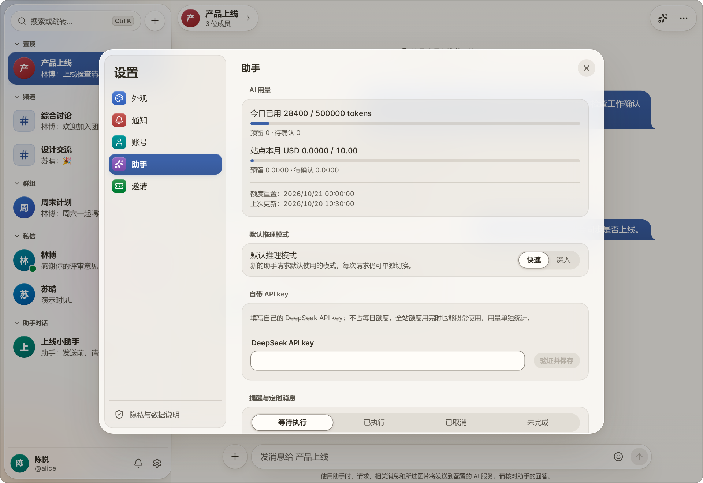
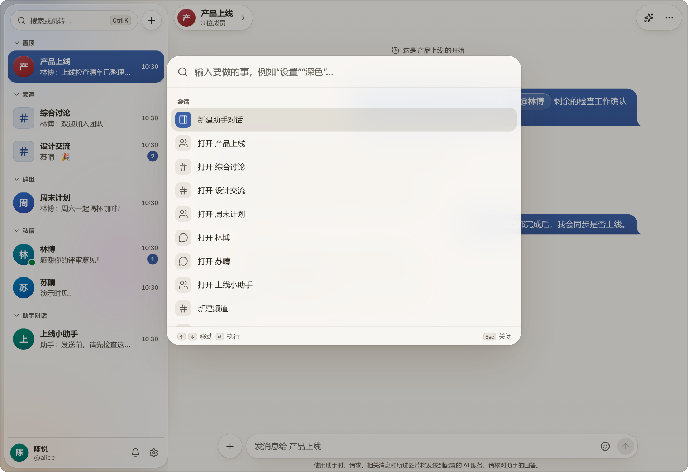
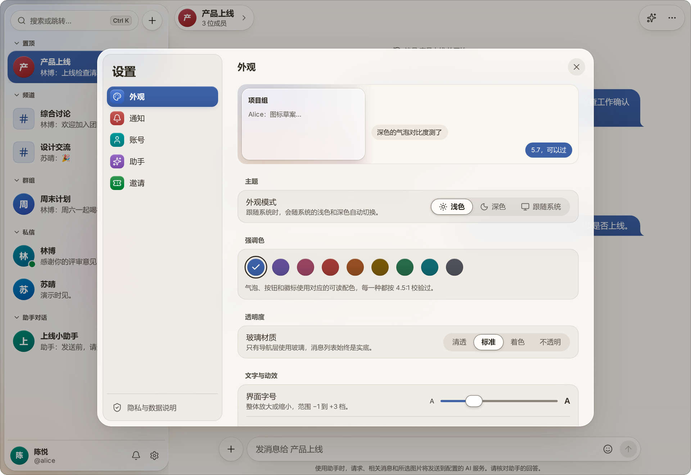
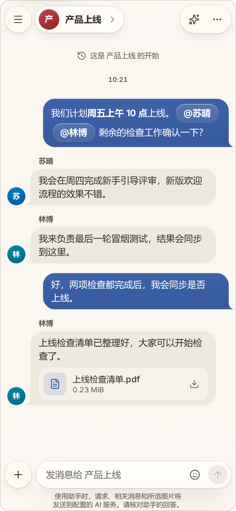

# ChatApp 产品导览

[English](demo.md) · **简体中文**

[返回中文 README](../README.zh-CN.md) · [打开 ChatApp](https://chatapp.software)

用十张图走一遍中文应用：讨论上线安排、分享文件、让 Agent 整理进展，并在执行前确认操作。

以下截图来自真实客户端，使用虚构人物、消息，以及浏览器内的 HTTP / WebSocket 演示响应。AI 回答和审批结果为预设演示数据，不涉及真实账号、私有对话、服务商凭据、AI 调用或消息投递。每张图都有浅色和深色两个版本，页面显示与你的 GitHub 主题一致的那一张。

## 1. 给讨论一个共同的空间

频道、私有群组、私信和助手对话集中在侧边栏。置顶会话更容易找到，未读标记帮助你发现新的讨论。

在**产品上线**中，陈悦 @苏晴 和 @林博 确认发布时间，三人分配检查工作，林博分享了「上线检查清单.pdf」。Markdown、提及、文件卡片和输入框都在同一个会话里。

<p>
  <picture>
    <source media="(prefers-color-scheme: dark)" srcset="assets/demo/zh-CN/01-workspace-dark.webp">
    
  </picture>
</p>

会话铺满整个窗口。侧栏、顶部的标题胶囊和工具胶囊、底部的输入栏，是悬浮在它上面的玻璃。

在自己的工作区中，可以创建群组、邀请伙伴，再把文件拖到会话的任意位置。新成员只能看到加入后的消息。

## 2. 凑近看消息

这是**设计交流**频道。苏晴 @了陈悦，所以这颗提及比提到别人时染得更满。陈悦用引用回复作答。分隔线标出她还没读的消息从哪里开始。林博的代码块带语法高亮，标着语言名，右上角可以复制。只有一个表情的消息会放大显示，不套气泡。

<p>
  <picture>
    <source media="(prefers-color-scheme: dark)" srcset="assets/demo/zh-CN/02-messages-dark.webp">
    
  </picture>
</p>

把指针移到消息上，可以看到发送时间，以及回复和更多操作；右键菜单里还有复制、编辑、撤回、仅自己删除、举报，以及把这条消息交给助手。

## 3. 在聊天旁边，让 Agent 帮你补齐进展

点击工具栏中的**助手**打开侧边面板。原始讨论仍在眼前，你可以边看聊天边阅读仅自己可见的答案。

面板提供**总结未读**、**翻译**和**起草回复**，支持**快速**或**深入**模式、独立的助手对话历史，以及将回答插入聊天输入框后再检查发送。

> 总结一下上线安排、负责人和接下来的待办。

<p>
  <picture>
    <source media="(prefers-color-scheme: dark)" srcset="assets/demo/zh-CN/03-agent-panel-dark.webp">
    
  </picture>
</p>

默认读取**当前会话**，需要更广泛的上下文时再明确选择**所有可访问会话**。如果希望全体成员都能看到回答，可以在群组或频道里 `@助手`，它只使用该会话成员共同可见的历史。

## 4. 查找上下文、起草，再确认行动

专属助手对话提供一个私有空间，让你围绕有权访问的多个会话继续工作。

> 找到「产品上线」中的讨论，帮我起草一条简短的进展更新。
>
> 把这条更新发到「产品上线」。

Agent 先准备草稿，再用审批卡展示目标会话和完整正文。你可以**批准**、**修改**或**拒绝**。发送和定时发送消息、建群、邀请成员，都需要审批。

<p>
  <picture>
    <source media="(prefers-color-scheme: dark)" srcset="assets/demo/zh-CN/04-agent-approval-dark.webp">
    
  </picture>
</p>

下一张截图是陈悦点击**批准**后的卡片状态。这里的审批响应是模拟的，用于展示界面，不会投递真实消息。

<p>
  <picture>
    <source media="(prefers-color-scheme: dark)" srcset="assets/demo/zh-CN/05-agent-approved-dark.webp">
    
  </picture>
</p>

展开助手回复中的**查看工具步骤**，可以了解工具调用过程。回答支持流式输出，可以停止正在生成的回复，或对符合条件的已完成回复重新生成。

## 5. 文件和成员，就在旁边

点击工具栏里的标题胶囊（**成员与详情**）。详情面板整合共享文件、成员、邀请链接、个人通知偏好，以及当前角色可使用的会话管理操作。

<p>
  <picture>
    <source media="(prefers-color-scheme: dark)" srcset="assets/demo/zh-CN/06-details-dark.webp">
    
  </picture>
</p>

应用还提供图片预览、音视频播放、文件下载、拖拽上传和头像编辑。本场景展示 PDF 文件卡片；上传和媒体播放需要另行操作体验。

## 6. 调整成适合自己的助手

在**设置 → 助手**选择默认推理模式、配置自己的 DeepSeek API key、查看用量，以及管理个人记忆、提醒和定时消息。

<p>
  <picture>
    <source media="(prefers-color-scheme: dark)" srcset="assets/demo/zh-CN/07-assistant-settings-dark.webp">
    
  </picture>
</p>

AI 配置完成后，可以试试：

- “明天上午 9 点提醒我检查上线结果。”
- “记住：我喜欢简短的进展更新，每项待办都列出负责人。”
- “把这条消息定时到周五上午 10 点发送，时区用 Asia/Singapore。”
- “找到之前讨论新手引导的消息，措辞不同也可以。”
- “把最近一条消息翻译成英文。”
- 附上一张图片，问：“这个设计改了什么？”

个人提醒和明确要求保存的记忆可以直接创建，会显示结果和撤销入口。涉及时间的操作会展示日期与时区。语义检索需要向量配置，图片理解需要兼容的模型。这些提示词介绍可用工作流，本导览没有调用真实 AI 执行它们。

## 7. 用键盘快速找到下一步

Windows / Linux 使用 **Ctrl+K**，macOS 使用 **⌘K** 打开命令面板。可以跳转会话、搜索消息、创建对话和打开设置。关键词消息搜索不消耗 AI 额度。

<p>
  <picture>
    <source media="(prefers-color-scheme: dark)" srcset="assets/demo/zh-CN/08-command-palette-dark.webp">
    
  </picture>
</p>

使用 **Ctrl+J / ⌘J** 切换助手面板；在输入框里用 **Ctrl+B / I / Shift+X** 加粗、斜体和删除线。完整快捷键可从工具栏菜单中的快捷键说明查看。

## 8. 选择喜欢的外观

**设置 → 外观**里是属于这台设备的选择：浅色、深色或跟随系统；九种强调色；玻璃的透明度从**清透**到**不透明**共四档；字号；减少动态效果；侧栏是否显示消息预览。最上面的预览会随你的选择变化。同一个应用提供中文和英文，支持的浏览器还可以安装桌面 PWA。

<p>
  <picture>
    <source media="(prefers-color-scheme: dark)" srcset="assets/demo/zh-CN/09-appearance-dark.webp">
    
  </picture>
</p>

每种强调色在两种主题下都校验过对比度；只有导航层使用玻璃，消息列表始终是实底。

## 9. 窄窗口

窄窗口下，界面会重排成单列会话，通过抽屉打开导航。桌面仍然是主要使用场景。

<p>
  <picture>
    <source media="(prefers-color-scheme: dark)" srcset="assets/demo/zh-CN/10-narrow-layout-dark.webp">
    
  </picture>
</p>

## 更新截图

安装仓库依赖后，从仓库根目录运行：

```bash
bun x playwright install chromium
bun run demo:capture --locale=zh-CN
```

更新英文截图时使用 `bun run demo:capture`。两种语言应分别执行，端口 `127.0.0.1:25178` 必须空闲。脚本启动真实 Vite 客户端，在浏览器中提供对应语言的合成数据，把十个场景在浅色主题和深色主题下各走一遍，并关闭自己的服务器。

脚本检查数据契约、所选语言、两种主题下的审批交互、弹窗关闭、浏览器运行错误、未覆盖的 API 请求，以及 390px 下的横向溢出。

窗口是 1280 × 880 CSS 像素（窄窗口为 390 × 844），每个 CSS 像素对应 1.5 个设备像素；浏览器的时钟固定在演示数据所在的时刻。第二张图只取窗口的一部分，其余都是整个窗口。每张图会加上窗口的圆角和一像素的边，因为它要放在一个不是窗口底色的页面上；图片保存为无损 WebP，有损编码会让玻璃下面的柔光出现色带。中文图片保存到 `docs/assets/demo/zh-CN/`，文件名是 `<场景>-<主题>.webp`；本地回执在 `.test-runs/readme-demo/zh-CN/`，失败记录单独保留。

界面里的中文和代码使用运行截图的那台机器上的字体，所以换一台机器拍，这些字形可能不同。

实现见 [`capture-readme.ts`](../apps/web/tools/capture-readme.ts) 和 [`readme-fixtures.ts`](../apps/web/tools/readme-fixtures.ts)，均不在生产客户端入口中。

以上属于产品展示。真实后端、模型质量、媒体上传、推送投递、设备行为和部署验收，见[测试指南](08-testing.md)。
